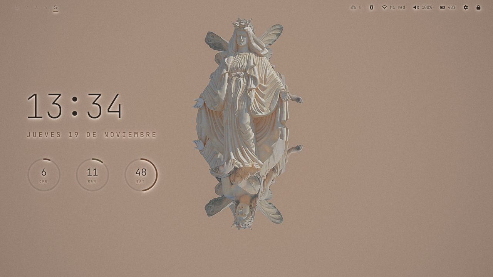
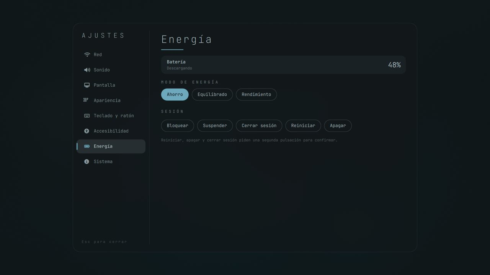

# 🧰 Miarch · Arch Linux + Hyprland

**La idea de este repositorio: dejar un Arch Linux mínimo convertido en este escritorio con tres comandos, sin configurar nada a mano.**

Un escritorio personal sobre **Hyprland**, con un entorno propio hecho en **Quickshell**: reloj y anillos de datos sobre el fondo, barra, lanzador de apps, paneles de Wi‑Fi y Bluetooth, ajustes del equipo, pantalla de bloqueo y pantalla de inicio de sesión. Los colores son mate y salen del wallpaper.


---

## 🚀 Instalación desde un Arch mínimo

Parte de un Arch recién instalado (perfil mínimo): solo necesitas **un usuario normal con `sudo`** y **conexión a internet**.

### 0. Conéctate a internet (solo si aún no lo estás)

En un Arch mínimo el Wi‑Fi se maneja con `iwd`. Entra a `iwctl` y conéctate a tu red (te pedirá la contraseña):

```bash
iwctl
  station wlan0 scan
  station wlan0 get-networks
  station wlan0 connect "NOMBRE_DE_TU_RED"
  exit
ping -c 1 archlinux.org
```

Si usas cable, ya debería haber conexión. Cuando termines de instalar, el Wi‑Fi se maneja con un panel de clics; no hay que volver a usar comandos.

### 1. Descarga el repositorio

```bash
sudo pacman -S --needed --noconfirm git base-devel
git clone https://github.com/alejandro-xoxo/Miarch.git ~/Miarch
cd ~/Miarch
```

### 2. Instala los paquetes y las configuraciones

```bash
./packages.sh     # paquetes (pacman y AUR), servicios y Oh My Zsh
./install.sh      # copia las configuraciones y los scripts a tu $HOME
```

Los dos se pueden ejecutar varias veces sin problema. `install.sh` guarda copias de seguridad (`*.bak-FECHA`) de lo que reemplaza.

### 3. Reinicia

Al iniciar sesión en la terminal (tty1), Hyprland arranca solo y aparece el escritorio. **Opcional:** para tener también una pantalla de inicio de sesión gráfica, ejecuta `./scripts/miarch-greeter-install` (más abajo).

> La primera vez, inicia sesión en las herramientas que usan cuenta: `claude`, `codex`, `agy` y `gh auth login`.

---

## 🖼️ Qué trae

### Colores mate que salen del wallpaper
Cada vez que cambias el fondo (`Super + W`), los colores del reloj, la barra, los paneles y la terminal se recalculan. Se adaptan solos a fondos claros u oscuros para que el texto siempre se lea.

| Fondo oscuro | Fondo claro |
|---|---|
|  |  |

### Lanzador de apps (`Super + Espacio`)
Búsqueda instantánea, entiende abreviaturas (`gcr` → Google Chrome) y ordena primero lo que más usas.


### Ajustes del equipo (`Super + ,`)
Un panel con clics para todo: red, sonido, pantalla, apariencia (fondos, animaciones, desenfoque), teclado y ratón, accesibilidad (tamaño de texto y cursor, alto contraste, reducir movimiento), energía y datos del sistema.

| Apariencia | Accesibilidad | Energía |
|---|---|---|
|  |  |  |

### Bloqueo (`Super + L`) e inicio de sesión
Mismo estilo en las dos pantallas: wallpaper desenfocado, reloj grande y la contraseña con puntos.

| Pantalla de bloqueo | Inicio de sesión |
|---|---|
|  |  |

### Música
Cuando algo suena (Spotify, el navegador…), aparece sola una tarjeta bajo los anillos con la portada, el título, el artista, la barra de progreso (clic para saltar) y los controles. También se ve en la barra y en la pantalla de bloqueo. Con Spotify: instala `spotify-launcher` (ya está en `packages.sh`), ábrelo una vez e inicia sesión.

### Dolphin y apps de Qt
Dolphin y cualquier app de Qt siguen la paleta del wallpaper (mismo acento y neutro), con la tipografía del escritorio e íconos oscuros, a través de `qt6ct`. Dolphin además es ligeramente translúcido para tomar el desenfoque, como la terminal.

### Wi‑Fi y Bluetooth con clics
En la barra, un clic en el Wi‑Fi o el Bluetooth abre un panel para ver las redes y dispositivos, y conectarte escribiendo la contraseña ahí mismo. *(No hay capturas de estos paneles porque muestran las redes y los dispositivos de quien las toma.)*

---

## ⌨️ Atajos

| Atajo | Acción |
|---|---|
| `Super + Enter` | Terminal (kitty) |
| `Super + Espacio` | Lanzador de apps |
| `Super + Shift + Espacio` | rofi (lanzador de respaldo) |
| `Super + Shift + Q` | Cerrar ventana |
| `Super + L` | Bloquear pantalla |
| `Super + ,` | Ajustes del equipo |
| `Super + W` | Cambiar wallpaper (y los colores) |
| `Super + B` | Navegador (Chrome) |
| `Super + V` / `Super + C` | VS Code / Claude Desktop |
| `Super + E` | Archivos (Dolphin) |
| `Super + F` | Ventana flotante |
| `Super + .` | Captura de una región al portapapeles |

---

## 🗂️ Estructura

| Ruta | Qué es |
|---|---|
| `packages.sh` | Instala paquetes (pacman y AUR) y activa los servicios |
| `install.sh` | Copia configuraciones y scripts a tu `$HOME` (con copia de seguridad) |
| `config/hypr/` | Hyprland (config en Lua; los ajustes del panel son variables al inicio) |
| `config/quickshell/miarch/` | El escritorio: `shell.qml` |
| `config/greeter/` | Pantalla de inicio de sesión (greetd + Quickshell) |
| `config/kitty/` · `config/nvim/` · `config/chrome/` | Terminal, Neovim, Chrome |
| `scripts/` | Herramientas del escritorio (abajo) |
| `docs/screenshots/` | Capturas de este README |
| `wallpapers/` | Fondos |

### Scripts

- **`wallpaper.sh`**: cambia el fondo (aleatorio o uno concreto) y regenera los colores.
- **`miarch-colors`**: saca una paleta mate del wallpaper y colorea kitty, Dolphin y las apps de Qt (`qt6ct`). Fastfetch y el prompt usan el mismo acento que el resto del escritorio.
- **`miarch-set`**: aplica un ajuste del panel (animaciones, blur, escala, teclado, accesibilidad…).
- **`miarch-wifi`**: puente con `iwd`; la contraseña se la da a `iwctl` por una terminal virtual, nunca como argumento de un comando.
- **`miarch-info`**: información del equipo para la página Sistema.
- **`miarch-fetch`**: fastfetch que se adapta al tamaño de la ventana (logo grande, pequeño o ninguno). `ff` lo vuelve a mostrar.
- **`miarch-greeter-install`**: instala la pantalla de inicio de sesión gráfica (pide sudo; no se activa hasta reiniciar).
- **`tomar-capturas`**: regenera las capturas de este README.

---

## 🔐 Qué instala y cómo

- **Paquetes oficiales** (`pacman`): repositorios firmados de Arch.
- **AUR** (`yay`): `quickshell-git`, `google-chrome`, `visual-studio-code-bin`, `claude-code`, `claude-desktop`, `antigravity-cli`, `hermes-webui-desktop-bin`. Son paquetes de la comunidad, **no firmados por Arch**; el script los instala con `--noconfirm` (sin mostrarte el PKGBUILD). Quita esa opción si prefieres revisarlos uno a uno.
- **Oh My Zsh y sus plugins**: se clonan con `git`; no se ejecuta ningún script descargado.
- **Servicios que activa**: `iwd`, `bluetooth`, `power-profiles-daemon`, `docker.socket` (Docker arranca solo cuando lo usas) y `ollama`.

### Desarrollo e IA local

- **Node.js** (LTS), **Docker** (con compose y buildx), **Ollama** (`ollama pull llama3.2`) y **DBeaver**.
- **Grupo `docker`**: el script añade tu usuario a él para usar Docker sin `sudo`. Ojo: estar en ese grupo equivale a tener acceso de administrador sobre el equipo. Cierra sesión y vuelve a entrar para que se aplique. Si no lo quieres, quita esas líneas de `packages.sh`.
- **Espacio en disco**: las imágenes de Docker y los modelos de Ollama pesan muchos GB. Si tu raíz (`/`) tiene menos de 100 GB y `/home` es otra partición, el script guarda sus datos en `/home/.datos-pesados`, **solo si todavía no tienen datos**. Si ya usabas Docker, no se mueve nada.
- **Hermes WebUI Desktop** es solo la *ventana* de escritorio: necesita un servidor `hermes-webui` en `localhost:8787` o remoto por SSH. Ejecutar el agente de Hermes en este equipo (`hermes-agent`, de AUR) exige Node 26 (no LTS) y Python 3.14, así que no se instala por defecto.

### Pantalla de inicio de sesión (opcional)

```bash
./scripts/miarch-greeter-install
```

Instala `greetd`, copia la pantalla y la deja lista para el **próximo arranque**. Si algo falla y no puedes entrar: `Ctrl + Alt + F2`, inicia sesión y ejecuta

```bash
sudo systemctl disable greetd && sudo systemctl enable getty@tty1
```

y reinicia: vuelves al inicio de sesión de texto de siempre.

---

## 🔄 Volver a aplicar o actualizar

```bash
cd ~/Miarch && git pull && ./install.sh
```

## 📸 Actualizar las capturas

Dentro de Hyprland, con el escritorio en marcha: `./scripts/tomar-capturas`. Usa un modo demo que oculta el nombre de tu red y deja todo como estaba al terminar.

## 📌 Requisitos

- Arch Linux (instalación mínima) con `sudo` configurado y red (Wi‑Fi con `iwd`).
- Probado en un portátil con Intel Core i5 de 8.ª generación. Si tienes otro hardware gráfico (AMD o NVIDIA), cambia `intel-media-driver` en `packages.sh` por el driver que corresponda.
