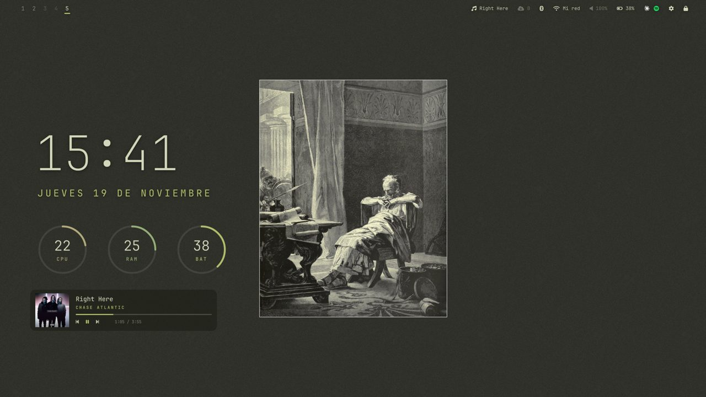
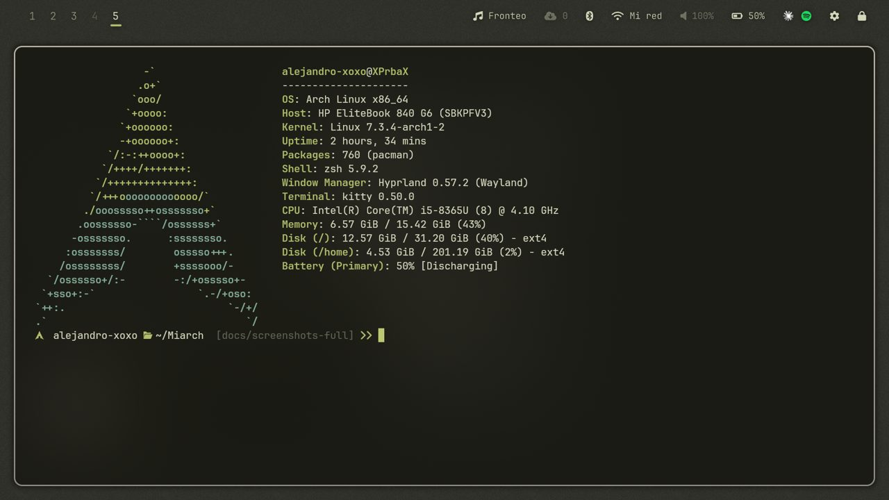
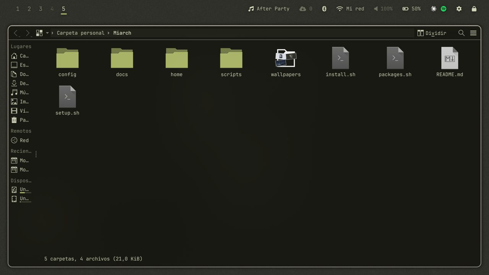
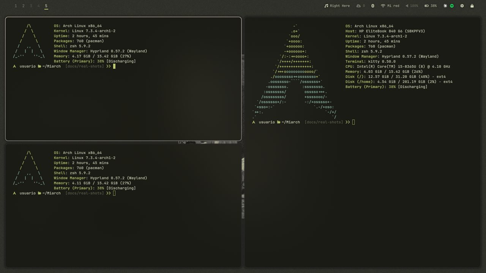
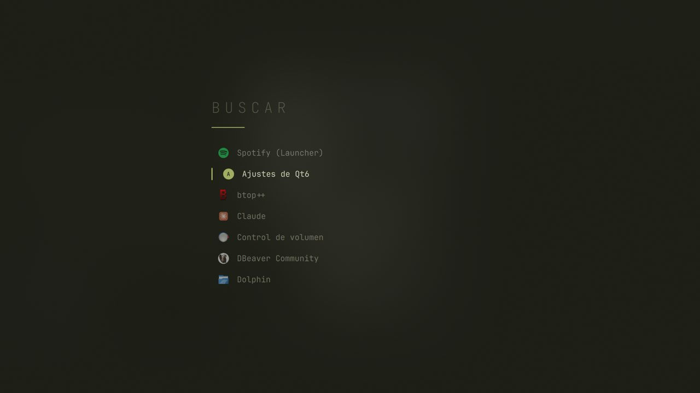
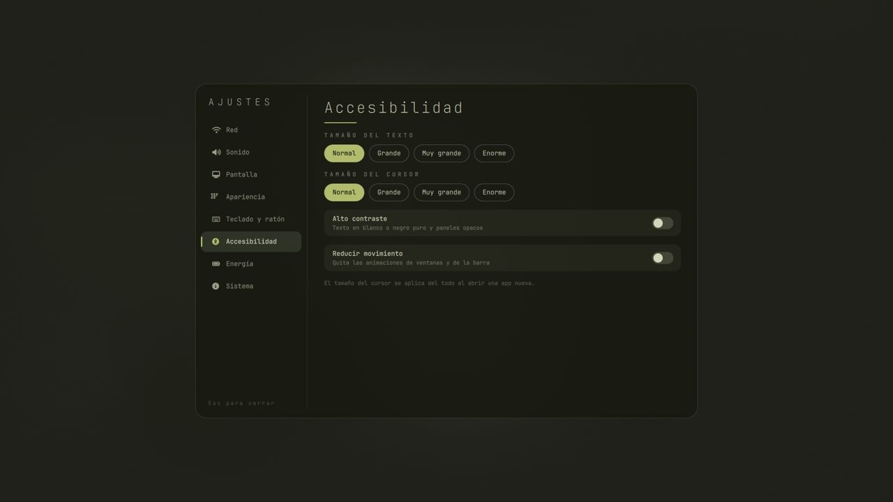
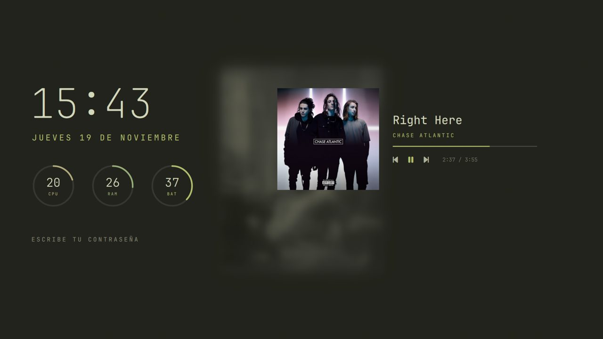
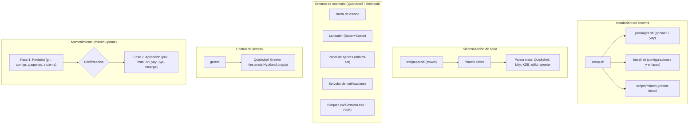

<div align="center">

```text
███╗   ███╗██╗ █████╗ ██████╗  ██████╗██╗  ██╗
████╗ ████║██║██╔══██╗██╔══██╗██╔════╝██║  ██║
██╔████╔██║██║███████║██████╔╝██║     ███████║
██║╚██╔╝██║██║██╔══██║██╔══██╗██║     ██╔══██║
██║ ╚═╝ ██║██║██║  ██║██║  ██║╚██████╗██║  ██║
╚═╝     ╚═╝╚═╝╚═╝  ╚═╝╚═╝  ╚═╝ ╚═════╝╚═╝  ╚═╝
```

**Arch Linux + Hyprland** &nbsp;·&nbsp; escritorio propio en Quickshell &nbsp;·&nbsp; **v1.0**


*by alejandro-xoxo*

</div>

# 🧰 Miarch · Arch Linux + Hyprland

**La idea de este repositorio: dejar un Arch Linux mínimo convertido en este escritorio con un solo comando, sin configurar nada a mano.**

Un escritorio personal sobre **Hyprland**, con un entorno propio hecho en **Quickshell**: reloj y anillos de datos sobre el fondo, barra, lanzador de apps, paneles de Wi‑Fi y Bluetooth, ajustes del equipo, pantalla de bloqueo y pantalla de inicio de sesión. Los colores son mate y salen del wallpaper.



---

## ✨ Lo más destacado

| Componente / Característica | Descripción |
| :--- | :--- |
| **Shell unificado en Quickshell** | Entorno declarativo en `shell.qml` (Qt6/QML) que consolida barra, lanzador, ajustes, notificaciones y bloqueo sin demonios independientes. |
| **Bloqueo y login cinemáticos** | Desbloqueo mediante WlSessionLock y PAM con secuencia de 5,6 s y pista sonora original generada algorítmicamente con `numpy`. |
| **Extracción adaptativa de color** | `wallpaper.sh` y `miarch-colors` generan una paleta mate sincronizada en Quickshell, kitty, aplicaciones KDE, qt6ct y la pantalla de acceso. |
| **Actualizador en dos fases** | `miarch-update` analiza commits, configuraciones pendientes y paquetes en una fase de revisión previa a la confirmación de aplicación. |
| **Pila de herramientas de IA** | Acceso directo a interfaces de escritorio y CLI para Claude, Codex, Antigravity y Hermes, junto con la skill estándar `skills/instalar-configurar`. |
| **Hyprland en Lua y ajustes que sobreviven** | Hyprland 0.57 configurado en Lua; el panel de Ajustes cambia variables que las actualizaciones conservan, y `~/.config/miarch/personal/` guarda tus cambios propios. |
| **Optimización para videojuegos** | Pila configurada con GameMode, MangoHud, Gamescope, Steam con escala de interfaz, zram, ntsync y controladores Vulkan según la GPU. |
| **Servicios y utilidades nativas** | Servidor de notificaciones en Quickshell, OSD de volumen mediante `wpctl` y puente Wi-Fi seguro conectado a `iwd`. |

---

## 🚀 Instalación (un solo comando)

Desde un Arch mínimo, con **un usuario normal con `sudo`** y **internet**, copia y pega:

```bash
sudo pacman -S --needed --noconfirm git && git clone https://github.com/alejandro-xoxo/Miarch ~/Miarch && ~/Miarch/setup.sh
```

Pide tu contraseña de `sudo` una sola vez. Tarda unos 30 minutos (compila Quickshell). Al terminar:

```bash
sudo reboot
```

Verás la **pantalla de inicio de sesión de Miarch**: escribe tu contraseña y entras al escritorio. (Si prefieres entrar por la terminal: `touch ~/.config/miarch/sin-greeter` antes de instalar.)

<details>
<summary>¿Sin internet? Conéctate al Wi‑Fi primero</summary>

```bash
iwctl station wlan0 connect "NOMBRE_DE_TU_RED"
```

Te pide la contraseña. Si tu tarjeta no se llama `wlan0`, mira su nombre con `iwctl station list`. Con cable ya debería haber conexión. Cuando termines de instalar, el Wi‑Fi se maneja con un panel de clics y no hace falta volver a usar comandos.
</details>

Si descargaste el ZIP de GitHub en vez de usar `git clone`, los permisos de ejecución se pierden: usa `bash setup.sh`.

**¿Ya lo tenías instalado de antes y no tiene la nube para actualizar?** Una sola vez:

```bash
cd ~/Miarch && git pull --ff-only && bash install.sh && hyprctl reload && (qs kill -c miarch; setsid qs -c miarch >/dev/null 2>&1 &)
```

Más detalle (por pasos, pantalla de inicio de sesión gráfica, seguridad): [docs/instalacion.md](docs/instalacion.md).

> La primera vez, inicia sesión en `claude`, `codex`, `agy` y `gh auth login`.

---

## 🖼️ Qué trae

### Colores mate que salen del wallpaper
Cada vez que cambias el fondo (`Super + W`), los colores del reloj, la barra, los paneles y la terminal se recalculan. Se adaptan solos a fondos claros u oscuros para que el texto siempre se lea.

| Fondo oscuro | Fondo claro |
|---|---|
|  |  |

### Terminal y archivos
La terminal (kitty) y Dolphin comparten la misma paleta, tipografía y acento que el resto del escritorio.

| Terminal con fastfetch | Dolphin |
|---|---|
|  |  |

**fastfetch se adapta al tamaño de cada terminal**: logo grande en una ventana amplia, logo pequeño en una mediana, solo los datos en una angosta y nada en una diminuta (`ff` lo vuelve a mostrar).



### Lanzador de apps (`Super + Espacio`)
Búsqueda instantánea, entiende abreviaturas (`gcr` → Google Chrome) y ordena primero lo que más usas.



### Ajustes del equipo (`Super + Esc`)
Un panel con clics para todo: red, sonido, pantalla, apariencia (fondos, animaciones, desenfoque), teclado y ratón, accesibilidad (tamaño de texto y cursor, alto contraste, reducir movimiento), energía y datos del sistema.

| Apariencia | Accesibilidad | Energía |
|---|---|---|
|  |  |  |

### Bloqueo (`Super + L`) e inicio de sesión
Mismo estilo en las dos pantallas: wallpaper desenfocado, reloj grande y la contraseña con puntos. Con música sonando, el bloqueo muestra la portada y los controles junto al reloj.

**Entrar es una pequeña película** (unos 5,6 s): barras de cine arriba y abajo, el fondo avanza despacio, aparece el título MIARCH con la firma *by alejandro-xoxo*, un destello horizontal cruza la pantalla y todo se aclara hasta quedar igual que tu escritorio. Al desbloquear suena una pieza de tráiler generada por código (sin muestras de terceros) y se teclea el **log real del sistema** (`journalctl`). La contraseña se verifica con PAM; un bloqueo nuevo cancela cualquier desbloqueo a medias.

| Pantalla de bloqueo | Inicio de sesión |
|---|---|
|  |  |

### Música
Cuando algo suena (Spotify, el navegador…), aparece sola una tarjeta bajo los anillos con la portada, el título, el artista, la barra de progreso (clic para saltar) y los controles. También se ve en la barra y, en grande y a la derecha del reloj, en la pantalla de bloqueo. Con Spotify: instala `spotify-launcher` (ya está en `packages.sh`), ábrelo una vez e inicia sesión.

### Dolphin y apps de Qt
Dolphin y cualquier app de Qt siguen la paleta del wallpaper (mismo acento y neutro), con la tipografía del escritorio e íconos oscuros, a través de `qt6ct` y `kdeglobals` (Dolphin, al ser de KDE, lee sus colores de ahí). Dolphin además es ligeramente translúcido para tomar el desenfoque, como la terminal.

### Menú de IA (`Super + C`)
Un menú solo con las apps de escritorio de IA: **Claude Desktop, Codex App, Antigravity y Hermes Desktop**, cada una con su logo. Las que no estén instaladas salen apagadas. Todas se instalan con el resto de paquetes.

### Notificaciones propias
El propio escritorio es el servidor de notificaciones: se deslizan arriba a la derecha con el estilo de los paneles, con icono, barra de progreso, botones de acción y una cuenta atrás que se pausa al pasar el ratón. Las críticas no se van solas. Clic cierra una, clic derecho las cierra todas.

### Volumen con sonido
Las teclas de volumen hacen un pitido corto y muestran una barra sencilla abajo que se va sola.

### Actualizador (la nube de la barra)
Un clic en la nube **revisa primero** (cambios nuevos en GitHub, paquetes que faltan o sobran, actualizaciones del sistema y de AUR), te enseña las novedades en español y pide **una sola confirmación**. Después hace solo lo necesario, conserva tus ajustes y tu fondo, y recarga el escritorio al final. Interfaz con barra de progreso y logo propios. Más en [docs/actualizador.md](docs/actualizador.md).

### Skill para agentes de IA
Si usas Claude Code, Codex o Antigravity, la instalación les deja una skill (`instalar-configurar`) que enseña al agente a instalar y configurar cosas en este sistema de la mejor forma: opción más ligera y nativa, midiendo cuando importa, y guardando los cambios donde ninguna actualización los borra. Más en [docs/ia.md](docs/ia.md).

### Juegos
Steam listo para jugar: controladores Vulkan de tu tarjeta, GameMode (sube el rendimiento mientras juegas y lo devuelve después), MangoHud, Gamescope con FSR para gráficas integradas y ProtonUp-Qt. Guía y opciones de lanzamiento en [docs/juegos.md](docs/juegos.md).

### Wi‑Fi y Bluetooth con clics
En la barra, un clic en el Wi‑Fi o el Bluetooth abre un panel para ver las redes y dispositivos, y conectarte escribiendo la contraseña ahí mismo. En el Wi‑Fi puedes **conectar, desconectar, olvidar** una red, entrar a una **red oculta** y escribir la clave nueva si una red guardada la cambió; solo se listan las redes que están a tu alcance. En Bluetooth, los emparejados que no se detectan cerca quedan escondidos tras un botón. *(No hay capturas de estos paneles porque muestran las redes y los dispositivos de quien las toma.)*

---

## 🏗️ Cómo está hecho

La arquitectura de Miarch desacopla la instalación del sistema, la sincronización de temas visuales y la ejecución de la interfaz de usuario. Los instaladores base despliegan dependencias y configuraciones preservando copias de seguridad y ajustes personales; el subsistema de fondos de pantalla calcula paletas de color mate que se distribuyen hacia las aplicaciones y el gestor de inicio de sesión (`greetd`); un único archivo central en Quickshell gobierna los paneles y la interacción de escritorio, mientras que el actualizador coordina revisiones y migraciones del sistema en etapas controladas.



## 🧰 Tecnologías

| Categoría | Herramienta / Paquete | Rol técnico |
| :--- | :--- | :--- |
| **Sistema base** | Arch Linux | Base del sistema operativo y gestión de dependencias. |
| **Compositor Wayland** | Hyprland 0.57 | Gestor de ventanas y composición gráfica, configurado mediante `hyprland.lua`. |
| **Shell y escritorio** | Quickshell (Qt6, QML) | Implementación de barra, paneles, notificaciones, menús y bloqueo en `shell.qml`. |
| **Inicio de sesión** | greetd, PAM | Gestor de autenticación gráfica con fallback a `agreety` y políticas `system-auth`. |
| **Terminal y entorno** | kitty, zsh, Oh My Zsh | Emulador de terminal acelerado por GPU y shell interactiva del usuario. |
| **Editor de código** | Neovim (Lazy.nvim) | Entorno de edición y gestión de extensiones. |
| **Navegador web** | Google Chrome | Navegador predeterminado configurado con flags nativas de Wayland y VA-API. |
| **Red y conectividad** | iwd (`iwctl`) | Demonio inalámbrico gestionado sin intermediarios mediante `miarch-wifi`. |
| **Pila de audio** | PipeWire, WirePlumber | Servidor de sonido y gestión de eventos multimedia mediante `wpctl`. |
| **Automatización** | Bash, Python 3, numpy | Lógica de scripts del sistema, interfaz `lib/ui.sh` y síntesis matemática de audio. |
| **Gaming** | Steam, GameMode, MangoHud, Gamescope | Pila de soporte para juegos con Vulkan específico de fabricante, ntsync y zram. |

## 🔒 Calidad y seguridad

- **Comprobaciones:** todos los scripts pasan `bash -n` y el análisis de Python, el QML se revisa con `qmllint`, y los flujos de instalación y actualización se prueban en entornos aislados (`$HOME` temporal y comandos privilegiados simulados).
- **Revisión previa a la v1.0:** el instalador, el actualizador, el bloqueo y el login se revisaron con un modelo de IA (Antigravity, nivel medio) y cada hallazgo se verificó a mano. Se corrigieron fallos reales, como un desbloqueo posible al volver a bloquear durante la animación, y se descartaron los falsos positivos. Es una autorrevisión cuidadosa, no una auditoría formal de terceros.
- **Bloqueo:** usa `WlSessionLock` y PAM; no existe desbloqueo automático de pruebas y un bloqueo nuevo cancela cualquier desbloqueo a medias.
- **Código de terceros:** los paquetes de AUR no están firmados por Arch y se instalan con `--noconfirm`; Hermes Desktop se instala ejecutando su script oficial y Codex App es un reempaquetado de una vista previa. Audita su procedencia si tu entorno es sensible.
- **Más detalle:** [docs/seguridad.md](docs/seguridad.md).

---

## 📚 Documentación

Cada tema tiene su propio archivo en [`docs/`](docs/README.md):

| Tema | Contenido |
|---|---|
| [Instalación](docs/instalacion.md) | Un comando, por pasos, Wi‑Fi, inicio de sesión gráfico, seguridad, consumo |
| [Paquetes](docs/paquetes/README.md) | Todo lo que se instala, por módulo, con su origen y para qué sirve |
| [Servicios](docs/servicios.md) | `iwd`, `bluetooth`, `power-profiles-daemon`, `docker`, `ollama` |
| [Zsh](docs/zsh.md) | Oh My Zsh, plugins, prompt y alias |
| [El escritorio](docs/escritorio.md) | Hyprland, Quickshell, colores del wallpaper, terminal, Neovim, Chrome |
| [Juegos](docs/juegos.md) | Steam: qué se instala, primer uso y opciones de lanzamiento |
| [Atajos](docs/atajos.md) | Todos los atajos de teclado |
| [Scripts](docs/scripts.md) | Qué hace cada herramienta |
| [Estructura](docs/estructura.md) | Mapa de carpetas del repositorio |
| [Actualizador](docs/actualizador.md) | Cómo revisa, qué hace y cómo conserva tus ajustes |
| [IA](docs/ia.md) | Menú de IA, skill para agentes y reglas del repositorio |
| [Seguridad](docs/seguridad.md) | Bloqueo, inicio de sesión, qué se ejecuta y revisión previa a la v1 |
| [Capturas](docs/capturas.md) | Cómo regenerar las imágenes de este README |

Atajos básicos: `Super + Enter` terminal · `Super + Espacio` lanzador · `Super + Esc` ajustes · `Super + Shift + Esc` menú de energía (apagar, reiniciar…) · `Super + L` bloquear · `Super + W` cambiar wallpaper.

---

## 📄 Licencia

Este proyecto está bajo la licencia Apache-2.0. Consulta los archivos [LICENSE](LICENSE) y [NOTICE](NOTICE) para más detalles.

Los logotipos y marcas comerciales de terceros (incluidos Anthropic, OpenAI, Google, Nous Research y Ollama) son propiedad de sus respectivos dueños y no están cubiertos por esta licencia.

