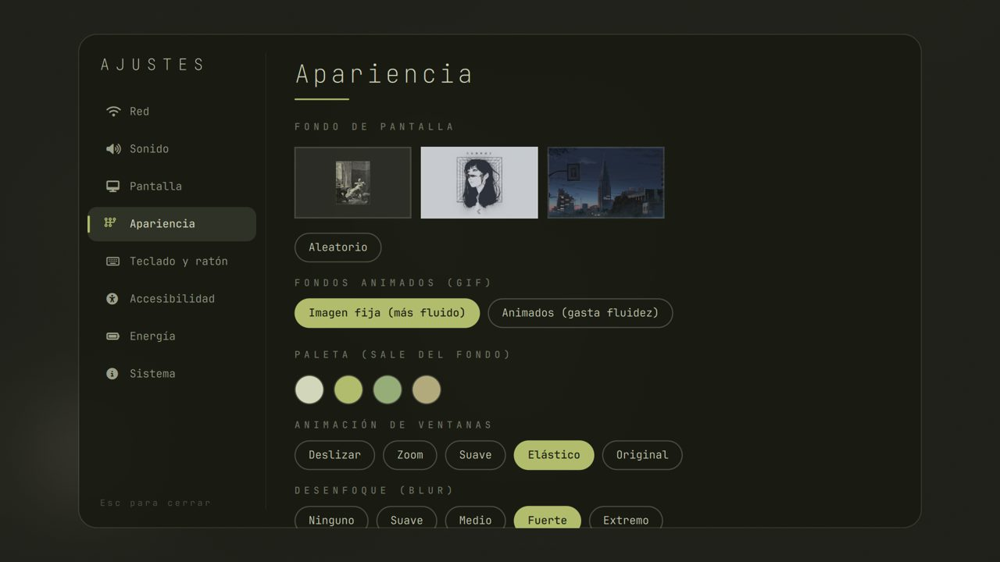
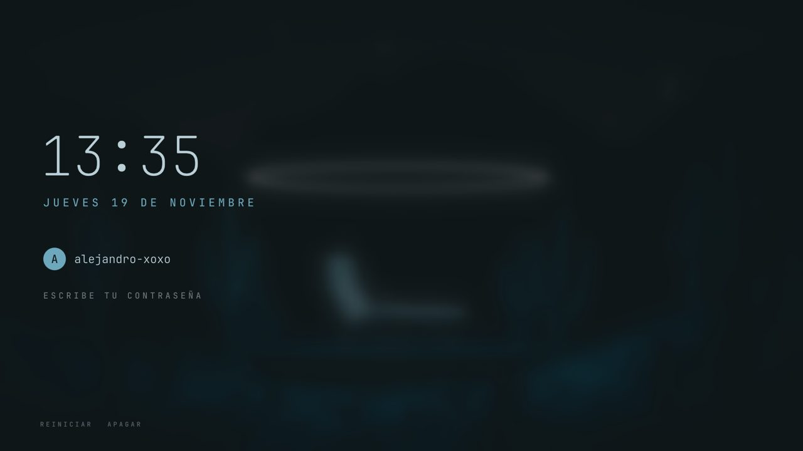

# 🧰 Miarch · Arch Linux + Hyprland

**La idea de este repositorio: dejar un Arch Linux mínimo convertido en este escritorio con un solo comando, sin configurar nada a mano.**

Un escritorio personal sobre **Hyprland**, con un entorno propio hecho en **Quickshell**: reloj y anillos de datos sobre el fondo, barra, lanzador de apps, paneles de Wi‑Fi y Bluetooth, ajustes del equipo, pantalla de bloqueo y pantalla de inicio de sesión. Los colores son mate y salen del wallpaper.


---

## 🚀 Instalación (un solo comando)

Desde un Arch mínimo, con **un usuario normal con `sudo`** y **internet**, copia y pega:

```bash
sudo pacman -S --needed --noconfirm git && git clone https://github.com/alejandro-xoxo/Miarch ~/Miarch && ~/Miarch/setup.sh
```

Pide tu contraseña de `sudo` una sola vez. Tarda unos 30 minutos (compila Quickshell). Al terminar:

```bash
sudo reboot
```

Inicia sesión en la terminal (tty1) y el escritorio arranca solo.

<details>
<summary>¿Sin internet? Conéctate al Wi‑Fi primero</summary>

```bash
iwctl station wlan0 connect "NOMBRE_DE_TU_RED"
```

Te pide la contraseña. Si tu tarjeta no se llama `wlan0`, mira su nombre con `iwctl station list`. Con cable ya debería haber conexión. Cuando termines de instalar, el Wi‑Fi se maneja con un panel de clics y no hace falta volver a usar comandos.
</details>

Si descargaste el ZIP de GitHub en vez de usar `git clone`, los permisos de ejecución se pierden: usa `bash setup.sh`.

**¿Ya lo tenías instalado de antes y no tiene la nube para actualizar?** Una sola vez:

```bash
cd ~/Miarch && git pull --ff-only && bash install.sh && hyprctl reload && (qs kill -c miarch; setsid qs -c miarch >/dev/null 2>&1 &)
```

Más detalle (por pasos, pantalla de inicio de sesión gráfica, seguridad): [docs/instalacion.md](docs/instalacion.md).

> La primera vez, inicia sesión en `claude`, `codex`, `agy` y `gh auth login`.

---

## 🖼️ Qué trae

### Colores mate que salen del wallpaper
Cada vez que cambias el fondo (`Super + W`), los colores del reloj, la barra, los paneles y la terminal se recalculan. Se adaptan solos a fondos claros u oscuros para que el texto siempre se lea.

| Fondo oscuro | Fondo claro |
|---|---|
|  |  |

### Terminal y archivos
La terminal (kitty) y Dolphin comparten la misma paleta, tipografía y acento que el resto del escritorio.

| Terminal con fastfetch | Dolphin |
|---|---|
|  |  |

**fastfetch se adapta al tamaño de cada terminal**: logo grande en una ventana amplia, logo pequeño en una mediana, solo los datos en una angosta y nada en una diminuta (`ff` lo vuelve a mostrar).


### Lanzador de apps (`Super + Espacio`)
Búsqueda instantánea, entiende abreviaturas (`gcr` → Google Chrome) y ordena primero lo que más usas.


### Ajustes del equipo (`Super + Esc`)
Un panel con clics para todo: red, sonido, pantalla, apariencia (fondos, animaciones, desenfoque), teclado y ratón, accesibilidad (tamaño de texto y cursor, alto contraste, reducir movimiento), energía y datos del sistema.

| Apariencia | Accesibilidad | Energía |
|---|---|---|
|  |  |  |

### Bloqueo (`Super + L`) e inicio de sesión
Mismo estilo en las dos pantallas: wallpaper desenfocado, reloj grande y la contraseña con puntos. Con música sonando, el bloqueo muestra la portada y los controles junto al reloj.

| Pantalla de bloqueo | Inicio de sesión |
|---|---|
|  |  |

### Música
Cuando algo suena (Spotify, el navegador…), aparece sola una tarjeta bajo los anillos con la portada, el título, el artista, la barra de progreso (clic para saltar) y los controles. También se ve en la barra y, en grande y a la derecha del reloj, en la pantalla de bloqueo. Con Spotify: instala `spotify-launcher` (ya está en `packages.sh`), ábrelo una vez e inicia sesión.

### Dolphin y apps de Qt
Dolphin y cualquier app de Qt siguen la paleta del wallpaper (mismo acento y neutro), con la tipografía del escritorio e íconos oscuros, a través de `qt6ct` y `kdeglobals` (Dolphin, al ser de KDE, lee sus colores de ahí). Dolphin además es ligeramente translúcido para tomar el desenfoque, como la terminal.

### Wi‑Fi y Bluetooth con clics
En la barra, un clic en el Wi‑Fi o el Bluetooth abre un panel para ver las redes y dispositivos, y conectarte escribiendo la contraseña ahí mismo. *(No hay capturas de estos paneles porque muestran las redes y los dispositivos de quien las toma.)*

---

---

## 📚 Documentación

Cada tema tiene su propio archivo en [`docs/`](docs/README.md):

| Tema | Contenido |
|---|---|
| [Instalación](docs/instalacion.md) | Un comando, por pasos, Wi‑Fi, inicio de sesión gráfico, seguridad, consumo |
| [Paquetes](docs/paquetes/README.md) | Todo lo que se instala, por módulo, con su origen y para qué sirve |
| [Servicios](docs/servicios.md) | `iwd`, `bluetooth`, `power-profiles-daemon`, `docker`, `ollama` |
| [Zsh](docs/zsh.md) | Oh My Zsh, plugins, prompt y alias |
| [El escritorio](docs/escritorio.md) | Hyprland, Quickshell, colores del wallpaper, terminal, Neovim, Chrome |
| [Atajos](docs/atajos.md) | Todos los atajos de teclado |
| [Scripts](docs/scripts.md) | Qué hace cada herramienta |
| [Estructura](docs/estructura.md) | Mapa de carpetas del repositorio |
| [Capturas](docs/capturas.md) | Cómo regenerar las imágenes de este README |

Atajos básicos: `Super + Enter` terminal · `Super + Espacio` lanzador · `Super + Esc` ajustes · `Super + Shift + Esc` menú de energía (apagar, reiniciar…) · `Super + L` bloquear · `Super + W` cambiar wallpaper.
