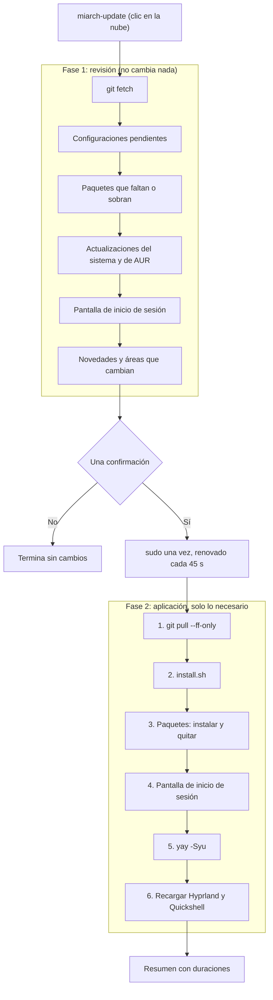

# Actualizador del sistema (miarch-update)

El actualizador de Miarch (`miarch-update`) mantiene el entorno al día en dos fases: una revisión previa que no cambia nada y la aplicación de solo lo que hace falta, tras una única confirmación. Se invoca desde la barra gráfica mediante el componente de Quickshell o directamente desde la terminal.

## Flujo de ejecución



## Número de la nube

El número que muestra la nube de la barra es la suma de lo pendiente:

| Concepto | Cuándo cuenta |
| :--- | :--- |
| Cambios nuevos | Commits disponibles en GitHub tras `git fetch`. |
| Configuraciones sin aplicar | Cambió algo que se instala (`config/`, `scripts/`, `home/`, `lib/`, `install.sh`, `setup.sh`, `packages.sh`, `skills/`, `AGENTS.md`) desde el commit guardado en `~/.cache/miarch/configs-aplicadas`. Un commit solo de documentación no cuenta. |
| Paquetes que faltan | `packages.sh --faltantes` devuelve algo. |
| Paquetes que sobran | `packages.sh --sobran` devuelve algo. |
| Pantalla de inicio de sesión | `greetd` no está activo, o cambiaron los archivos del login. |

Clic izquierdo en la nube ejecuta `miarch-update`; clic derecho ejecuta `miarch-update --forzar`, que vuelve a aplicar las configuraciones aunque no haya cambios nuevos.

## Fase 1: Revisión

La primera fase inspecciona el estado del sistema sin modificar archivos ni instalar paquetes:

1. **Sincronización remota:** Ejecuta `git fetch` para consultar novedades en el repositorio.
2. **Filtrado de rutas para configuraciones:** Compara el último commit registrado en el marcador `~/.cache/miarch/configs-aplicadas` con el commit actual. Solo se consideran pendientes cambios que impacten en las siguientes rutas del repositorio:
   - `config/`
   - `scripts/`
   - `home/`
   - `lib/`
   - `install.sh`
   - `setup.sh`
   - `packages.sh`
   - `skills/`
   - `AGENTS.md`
3. **Inspección de paquetería:**
   - Detecta dependencias faltantes u obsoletas del repositorio mediante flags de `packages.sh`.
   - Consulta actualizaciones del sistema oficiales mediante `checkupdates` y paquetes AUR mediante `yay -Qua`.
4. **Inspección de login:** Comprueba si el greeter gráfico está activo en systemd o si sus fuentes han cambiado.
5. **Informe previo:** Imprime las áreas del sistema sujetas a modificación y despliega hasta 3 títulos de entradas no leídas del archivo `NOVEDADES.md`.
6. **Confirmación:** Solicita una única aprobación interactiva antes de proceder.

## Fase 2: Aplicación y orden de ejecución

Si el usuario aprueba la operación, `miarch-update` aplica exclusivamente los pasos requeridos en un orden estricto para evitar inconsistencias:

1. **Descarga de código:** Ejecuta `git pull --ff-only`. Si tienes cambios locales sin guardar, no descarga nada y te avisa, para no pisarlos.
2. **Aplicación de configuraciones:** Invoca `install.sh`, copiando los archivos de `config/` y `scripts/` a `$HOME`.
3. **Gestión de paquetes:** Instala dependencias nuevas y remueve paquetes declarados obsoletos.
4. **Pantalla de inicio de sesión:** Configura `greetd` y sincroniza assets de `/usr/share/miarch/greeter` y `/var/lib/miarch-greeter`.
5. **Actualización de paquetes del sistema:** Ejecuta `yay -Syu --noconfirm`.
6. **Reinicio del entorno gráfico:** Como última acción del proceso, recarga Hyprland y reinicia Quickshell cuando los paquetes ya están actualizados, para que no quede corriendo un binario viejo.

## Gestión de privilegios (sudo)

Para evitar interrupciones o fallos durante compilaciones prolongadas en AUR:
- El actualizador pide la contraseña de `sudo` una sola vez, justo después de la confirmación y solo si algún paso la necesita.
- Inicia un temporizador en segundo plano que renueva la validez de las credenciales cada 45 segundos mientras la ejecución continúa activa.

## Preservación del entorno y personalizaciones

El proceso de actualización protege el estado definido por el usuario:

- **Variables del panel:** Durante la ejecución de `install.sh` se conservan los valores asignados a `ESCALA`, `KB`, `NATURAL`, `TAP`, `SENS`, `CURSOR`, `MOVIMIENTO`, `ANIM` y `BLUR`.
- **Fondos y paleta de colores:** No modifica el fondo de pantalla activo ni los esquemas de color generados previamente.
- **Configuraciones personales:** El directorio `~/.config/miarch/personal/` (`hyprland.lua`, `kitty.conf`, `zshrc`) es ignorado por las actualizaciones y nunca se sobreescribe.
- **Respaldos incrementales:** Toda sustitución de archivos en `$HOME` genera respaldos con formato `*.bak-DATE`. El sistema purga automáticamente versiones antiguas, manteniendo únicamente los 2 respaldos más recientes.
- **Árbol Git:** `git pull --ff-only` nunca fusiona ni pisa cambios locales.

## Exclusiones voluntarias (Opt-outs)

Para prescindir de la pantalla de inicio de sesión gráfica (`greetd`), el usuario puede crear el archivo marcador:

```bash
touch ~/.config/miarch/sin-greeter
```

Si dicho archivo existe, tanto `setup.sh` como `miarch-update` omiten la instalación, configuración y activación del greeter.

## Salida por terminal y registros

- **Biblioteca `lib/ui.sh`:** Controla la presentación en consola mediante tres modos según el entorno (ASCII, consola estándar y modo enriquecido con paleta morada, spinner animado, barras de progreso y cajas de resumen con duración de tareas).
- **Archivo de log:** Toda la salida detallada y posibles errores de ejecución se registran en:
  ```text
  ~/.cache/miarch/instalacion.log
  ```

## Forzado de actualización

Vuelve a aplicar las configuraciones y los scripts (`install.sh`) aunque no haya cambios nuevos:

```bash
miarch-update --forzar
```

También puede dispararse de manera gráfica haciendo clic derecho sobre el icono de la nube en la barra de Quickshell.

## Diagnóstico y resolución de incidencias

### Error en `git pull` por cambios locales
- **Causa:** Existen archivos locales modificados que impiden realizar una fusión rápida (`--ff-only`).
- **Solución:** Confirmar los cambios locales o revertirlos antes de volver a ejecutar `miarch-update`.

### Fallo en el inicio de sesión gráfico (`greetd`)
Si la interfaz gráfica de inicio no carga y no permite ingresar al sistema:
1. Cambiar a una terminal virtual alternativa mediante `Ctrl+Alt+F2`.
2. Iniciar sesión con las credenciales de usuario.
3. Deshabilitar `greetd` y restaurar la consola estándar en tty1:
   ```bash
   sudo systemctl disable greetd && sudo systemctl enable getty@tty1
   ```
4. El respaldo previo del archivo de configuración se encuentra disponible en `/etc/greetd/config.toml.miarch-bak`.
5. Si `greetd` falla en menos de 8 segundos, el sistema tiene configurado el retorno automático a login en texto (`agreety`).

### Errores en instalación de paquetes o scripts
Revisar el archivo de registro con:
```bash
cat ~/.cache/miarch/instalacion.log
```
- **Hermes Desktop:** Ante cortes de red, comprueba conectividad hasta 4 veces y reintenta la instalación hasta 3 veces antes de posponerla a la próxima actualización.
