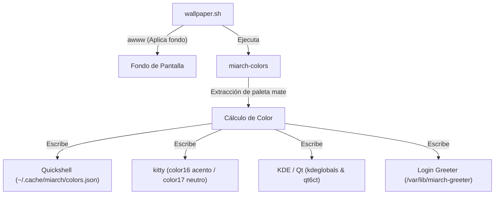

# Arquitectura del Escritorio

El entorno de escritorio de Miarch está construido sobre el compositor Wayland Hyprland y una capa de interfaz gráfica personalizada desarrollada en Quickshell (Qt6/QML). La integración coordina el compositor, el servidor de interfaz, la extracción dinámica de paletas de color y los servicios de audio y red del sistema.

## Compositor: Hyprland (`config/hypr/hyprland.lua`)

La configuración del compositor se gestiona íntegramente en Lua sobre Hyprland 0.57 en el archivo `config/hypr/hyprland.lua`. 

Al inicio del archivo se exponen las variables principales de configuración que el panel de Ajustes manipula mediante la utilidad `miarch-set`:
- `ESCALA`: Factor de escala de la pantalla.
- `KB`: Distribución del teclado.
- `NATURAL`: Desplazamiento natural del panel táctil.
- `TAP`: Activación de pulsación mediante toque en el panel táctil.
- `SENS`: Sensibilidad del puntero.
- `CURSOR`: Tamaño del cursor (24, 32, 40 o 48).
- `MOVIMIENTO`: Modo de accesibilidad con reducción de movimiento.
- `ANIM`: Presets de animación (`slide`, `zoom`, `suave`, `elastico`, `original`).
- `BLUR`: Nivel de desenfoque (`ninguno` hasta `extremo`).

El archivo define también las reglas de ventana y los atajos de teclado globales (ver [atajos](atajos.md)). Debido a que la variable de entorno `PATH` inicial de Hyprland no incluye `~/.local/bin`, las invocaciones a utilidades locales (como `miarch-volumen`) se enlazan mediante su ruta absoluta.

En mediciones de consumo sobre un procesador Intel Core i5-8365U con cargas concurrentes (Chrome, VS Code, Spotify y Claude abiertos), Hyprland mantiene una utilización aproximada del 10% de un hilo de CPU y 230 MB de memoria RAM.

## Shell del Sistema: Quickshell (`config/quickshell/miarch/shell.qml`)

La interfaz de usuario del sistema está implementada en un único archivo modular estructurado por secciones (`config/quickshell/miarch/shell.qml`), ejecutado bajo Quickshell con Qt6. En el mismo entorno de prueba (Intel Core i5-8365U), Quickshell registra un uso aproximado del 9% de un hilo de CPU y 400 MB de memoria RAM.

### Módulos de la Shell

| Módulo | Atajo / Activador | Descripción Técnica |
|---|---|---|
| Escritorio | Segundo plano continuo | Capa sobre el fondo de pantalla con reloj, fecha, anillos de telemetría (uso de CPU, RAM y nivel de batería) y tarjeta de control multimedia. |
| Barra | Borde superior | Panel persistente que aloja selector de espacios de trabajo, control de música, indicador de actualizaciones del sistema (icono de nube), estados de Bluetooth, Wi-Fi, volumen, batería, acceso a ajustes y bloqueo. |
| Lanzador | `Super + Espacio` | Buscador de aplicaciones con soporte para coincidencias por abreviaturas y ordenación dinámica según frecuencia de uso. |
| Conexiones | Clic en la barra | Paneles emergentes para la administración de interfaces Wi-Fi y dispositivos Bluetooth. |
| Ajustes | `Super + Esc` | Centro de configuración del sistema dividido en red, sonido, pantalla, apariencia, teclado y ratón, accesibilidad, energía y sistema. Aplica cambios escribiendo las variables mediante `miarch-set`. |
| Menú de Energía | `Super + Shift + Esc` | Interfaz de sesión estructurada en dos pestañas: Energía (bloqueo, suspensión, cierre de sesión, reinicio, apagado) y Atajos. |
| Menú IA | `Super + C` | Menú de lanzadores de herramientas de inteligencia artificial con iconos de LobeHub Icons (licencia MIT): Claude Desktop (`claude-desktop`), Codex App (`openai-chatgpt`), Antigravity (`antigravity`) y Hermes Desktop (`~/.hermes`). Las aplicaciones no instaladas se renderizan atenuadas. |
| Bloqueo | `Super + L` | Bloqueo de sesión (`WlSessionLock` + PAM) con secuencia de entrada cinematográfica. Ver más abajo. |
| Notificaciones | Servidor de notificaciones | Tarjetas propias que reemplazan a `dunst`. Ver más abajo. |
| Volumen (OSD) | Atajos multimedia | Indicador en pantalla (OSD) sincronizado con el control de volumen. |

## Generación Dinámica de Colores

El script `wallpaper.sh` gestiona la asignación del fondo de pantalla mediante la herramienta `awww` e invoca al generador `miarch-colors`. Este analiza la imagen activa para extraer una paleta cromática de acabado mate, adaptándose a fondos claros y oscuros. En el caso de imágenes GIF, se extrae un fotograma estático para procesar la muestra de color.

Los valores de la paleta calculada se exportan de forma sincronizada a múltiples destinos del sistema:
- Shell Quickshell: `~/.cache/miarch/colors.json`.
- Terminal kitty: configuración dinámica (`color16` para color de acento, `color17` para tono neutro).
- Aplicaciones KDE y Qt: archivos de esquema `kdeglobals` y `qt6ct`.
- Pantalla de inicio de sesión: `/var/lib/miarch-greeter`.



## Pantalla de Bloqueo

La pantalla de bloqueo está implementada mediante el protocolo `WlSessionLock` de Quickshell integrado con PAM a través del servicio `system-auth`.

### Elementos Visuales y Funcionales
La interfaz despliega el fondo de pantalla desenfocado, un reloj de gran formato, anillos de monitoreo de recursos, tarjeta multimedia y un campo de entrada para contraseña punteada.

### Secuencia Cinematográfica de Desbloqueo
Tras la validación correcta de credenciales, se dispara una secuencia de transición de 5.6 segundos de duración:
1. Despliegue de bandas negras horizontales tipo buzón (*letterbox*), ocupando un 12.8% de la altura superior e inferior cada una.
2. Acercamiento progresivo de la imagen de fondo (*push-in* de +12%).
3. Aplicación de viñeteado óptico y tipografía gradual del registro real del sistema (`journalctl`) al inicio del proceso.
4. Aparición del título "MIARCH" con incremento progresivo de interletraje y la firma "by alejandro-xoxo".
5. Destello anamórfico horizontal (*flare*) sincronizado exactamente al 76% de la línea de tiempo.
6. Resplandor de luz (*bloom*) y desvanecimiento hacia el fondo nítido a escala 1:1 coincidente con la geometría del escritorio.

### Síntesis de Audio
El diseño sonoro se genera sintéticamente sin muestras externas mediante el script `config/quickshell/miarch/sonidos/generar-desbloqueo.py` utilizando `numpy`. Produce una señal de 8.2 segundos consistente en una entrada de metales (*brass swell*), silencio transitorio, impacto profundo en el segundo 4.26, resonancia metálica, sección de cuerdas y reverberación de catedral.

### Parámetros de Seguridad
- Una orden de bloqueo posterior interrumpe y anula cualquier animación de desbloqueo en progreso.
- Cada bifurcación de desbloqueo exige un resultado positivo y en vivo de la transacción PAM.
- La variable con la contraseña tecleada se vacía tras usarla (QML no permite garantizar el borrado físico de la memoria).
- La base de código carece de mecanismos o funciones de desbloqueo automático para pruebas.

## Pantalla de Inicio de Sesión (`config/greeter/`)

El gestor de acceso gráfico se basa en el demonio `greetd` ejecutando una sesión dedicada de Hyprland bajo el usuario de sistema `greeter` con la interfaz en Quickshell (`config/greeter`).

- **Estética y comportamiento**: Replica la presentación de la pantalla de bloqueo y reproduce la animación de bienvenida ("BIENVENIDO, <usuario>").
- **Tolerancia a fallos**: Dispone de un temporizador de seguridad de 8 segundos; si la sesión gráfica no completa su inicialización en dicho periodo, conmuta automáticamente al inicio en modo texto mediante `agreety`.
- **Instalación y configuración**: Desplegado mediante `scripts/miarch-greeter-install`, el cual instala `greetd`, transfiere los archivos a `/usr/share/miarch/greeter`, copia el fondo y paleta a `/var/lib/miarch-greeter`, respalda la configuración existente como `/etc/greetd/config.toml.miarch-bak` y activa el servicio `systemd`.
- **Inhabilitación y recuperación**: Se puede omitir su instalación creando el archivo testigo `~/.config/miarch/sin-greeter`. Si se requiere restaurar el acceso manual desde la consola de emergencia (`Ctrl+Alt+F2`), se ejecuta:
  ```bash
  sudo systemctl disable greetd && sudo systemctl enable getty@tty1
  ```

## Servidor de Notificaciones

Quickshell asume el rol de demonio de notificaciones del sistema tras la desinstalación y sustitución de `dunst`.

- **Presentación**: Las tarjetas se animan deslizándose en el cuadrante superior derecho, bajo el margen de la barra principal. Contienen icono, nombre de la aplicación de origen, título, cuerpo de texto, barras de progreso (utilizadas en eventos de volumen o brillo) y botones de acción.
- **Temporización**: Incluyen una cuenta regresiva visual que suspende su decremento al mantener el cursor sobre la tarjeta (*hover*). Las notificaciones con prioridad crítica permanecen fijas hasta su intervención manual.
- **Interacción y control**: Clic izquierdo descarta la notificación individual; clic derecho descarta la totalidad de alertas acumuladas. Para interacción por línea de comandos o scripts:
  ```bash
  qs -c miarch ipc call notif cerrar
  ```
- **Seguridad**: El resumen y el nombre de la aplicación se procesan y renderizan como texto plano estricto. Las etiquetas e imágenes incrustadas dentro del cuerpo son eliminadas para evitar distorsiones o inyecciones de marcado.

## Control de Volumen y OSD

La gestión de audio está implementada en `scripts/miarch-volumen` interactuando con PipeWire y WirePlumber mediante `wpctl`:
- **Comandos**: Acepta los parámetros `up`, `down` y `mute`.
- **Retorno auditivo**: Reproduce la señal acústica de volumen de `sound-theme-freedesktop`, regulada por un limitador de frecuencia que restringe su emisión a un máximo de una ejecución cada 110 ms.
- **Visualización OSD**: Muestra una barra sencilla, sin animación, durante 1,2 segundos mediante la llamada IPC:
  ```bash
  qs -c miarch ipc call osd mostrar <0-100> <texto> <1 si está en silencio>
  ```

## Paneles de Conectividad

### Panel Wi-Fi
La interacción inalámbrica se ejecuta a través del script mediador `scripts/miarch-wifi`, que traduce las operaciones entre la interfaz QML e `iwd` (`iwctl`), respondiendo con estructuras de datos en formato JSON:
- **Operaciones soportadas**: `list`, `scan`, `connect`, `connect-hidden`, `disconnect`, `forget` y `power`.
- **Seguridad de credenciales**: La clave de red se transmite al script exclusivamente mediante la variable de entorno `MIARCH_PASS` y se introduce al proceso secundario mediante un pseudoterminal (*pty*), evitando la exposición de contraseñas en los argumentos de la tabla de procesos del sistema.
- **Control de estado**: Si una red guardada rechaza la conexión por cambio de clave, el panel solicita la nueva credencial. Solo se listan redes verificadas dentro del radio de alcance. Las solicitudes de apagado y olvido comprueban el estado efectivo tras su ejecución. Las acciones se registran en `~/.cache/miarch/wifi.log`, que se recorta al pasar de 100 KB.

### Panel Bluetooth
Presenta la lista de dispositivos periféricos vinculados y gestiona el emparejamiento y la conexión. Para los dispositivos ya emparejados, la conexión o desconexión se gestiona de forma inmediata con las funciones nativas del objeto Bluetooth de Quickshell. Para vincular dispositivos nuevos no emparejados, el panel delega en el script mediador `scripts/miarch-bluetooth`:
- **Emparejamiento seguro y secuencial**: Admite solo un emparejamiento concurrente, ignorando pulsaciones adicionales mientras haya una vinculación en curso. Si el adaptador tiene el modo emparejable desactivado al abrir el panel, se activa (`pairable = true`, `pairableTimeout = 0`) una sola vez sin repetirlo en cada refresco.
- **Agente dedicado**: `miarch-bluetooth pair <MAC>` registra un agente efímero con capacidad `NoInputNoOutput` para la duración del comando (`timeout 45 bluetoothctl --agent NoInputNoOutput pair MAC`), evitando que `bluetoothd` quede colgado esperando respuestas interactivas. Al completarse, registra confianza (`trust`) y conecta el dispositivo (`connect`).
- **Validación y tolerancia a fallos**: Comprueba previamente la capacidad de respuesta del servicio (`timeout 6 bluetoothctl show`), validando la dirección MAC (`^([0-9A-F]{2}:){5}[0-9A-F]{2}$`). Si el demonio no responde, sugiere el comando para reiniciar el servicio.
- **Temporización y retroalimentación en la interfaz**: Muestra el estado "Emparejando…" bajo el dispositivo. Si transcurren 30 segundos sin completarse, cancela la operación (`cancelPair()`) y muestra un mensaje indicando que se ponga el dispositivo en modo de emparejamiento. Cada intento se registra en `~/.cache/miarch/bluetooth.log` (rotado a 100 KB).
- **Filtro de presencia**: Los dispositivos emparejados que no emitan señal detectable en las inmediaciones (sin RSSI activo) permanecen ocultos tras un botón expandible para evitar saturación visual.

## Terminal Kitty (`config/kitty/kitty.conf`)

El emulador de terminal kitty está configurado para reflejar las variables estéticas del entorno:
- Asignación de colores basada en el fondo actual (`color16` para el tono de acento y `color17` para el tono neutro).
- Tipografía unificada con el resto de la interfaz.
- Nivel moderado de transparencia en la ventana.

## Entorno de Edición Neovim (`config/nvim/init.lua`)

El editor Neovim cuenta con una configuración modular estructurada alrededor del gestor de complementos Lazy.nvim. Durante el despliegue del sistema, el script `install.sh` inicializa y sincroniza automáticamente las dependencias y plugins definidos.

## Navegador Web Chrome (`config/chrome/chrome-flags.conf`)

Google Chrome actúa como navegador web predeterminado del sistema, configurado a través de flags en `config/chrome/chrome-flags.conf`:
- Ejecución nativa sobre el protocolo Wayland.
- Aceleración de decodificación y renderizado de vídeo por hardware mediante VA-API.

## Apps Electron nítidas

Para garantizar que aplicaciones basadas en Electron y Chromium (como VS Code, Claude Desktop, ChatGPT, Antigravity o Hermes Desktop) se visualicen nítidas en monitores con escala:
- **Backend nativo en Wayland**: En `config/hypr/hyprland.lua` se define la variable de entorno `ELECTRON_OZONE_PLATFORM_HINT=wayland`, haciendo que los binarios modernos de Electron utilicen Wayland sin pasar por XWayland.
- **Archivos de flags dedicados**: `config/vscode/code-flags.conf`, `config/claude-desktop/claude-desktop-flags.conf` y `config/electron/electron-flags.conf` configuran `--ozone-platform=wayland`, `--enable-features=WaylandWindowDecorations,UseOzonePlatform` y `--enable-wayland-ime`, desplegados a `~/.config/` por `install.sh`.
- **Lanzadores y menú de IA**: En `config/quickshell/miarch/shell.qml` (menú de IA, `Super + C`) y en las sobrescrituras de lanzadores `.desktop` de usuario (`config/applications/`, desplegados a `~/.local/share/applications/` por `install.sh` para ChatGPT, Claude Desktop y Antigravity) se pasan explícitamente `--ozone-platform=wayland --enable-wayland-ime` en sus comandos de ejecución (`Exec=`), garantizando su apertura nítida en Wayland nativo tanto desde el menú como desde el lanzador de aplicaciones (`Super + Espacio`) sin depender de reiniciar sesión.
- **Escalado XWayland sin borrosidad**: En el bloque `xwayland` de Hyprland se fija `force_zero_scaling = true`, evitando que las aplicaciones que aún requieran XWayland sean escaladas borrosamente por el compositor.

Las aplicaciones Electron que ya estuviesen abiertas deben cerrarse y volver a abrirse para que arranquen con los nuevos parámetros y se vean nítidas.

## Componentes Heredados (`config/waybar/`)

El directorio `config/waybar/` almacena la configuración de la barra de estado previa a la migración a Quickshell. Se mantiene dentro del repositorio únicamente como referencia histórica y no participa en la ejecución del entorno.
