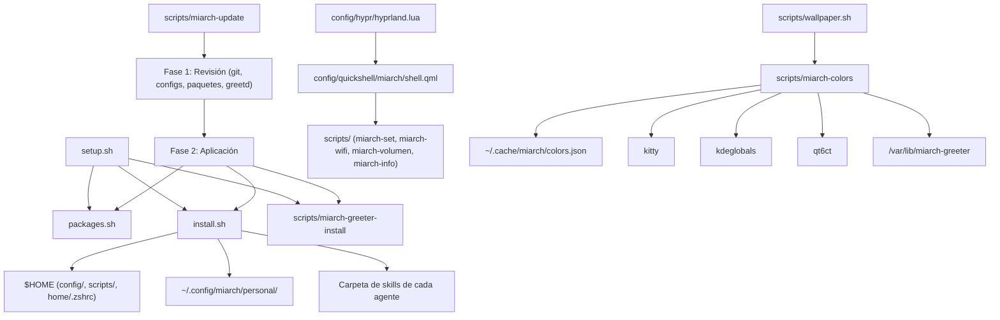

# Estructura del repositorio

Este documento describe la organización del repositorio Miarch, la función de cada componente y la interacción entre instaladores, capas de configuración, entorno gráfico, utilidades del sistema y extensiones de automatización.

---

## Árbol de archivos

```text
Miarch/
├── AGENTS.md
├── CLAUDE.md
├── NOVEDADES.md
├── setup.sh
├── packages.sh
├── install.sh
├── lib/
│   └── ui.sh
├── scripts/
│   ├── miarch-chrome-tema
│   ├── miarch-colors
│   ├── miarch-fetch
│   ├── miarch-greeter-install
│   ├── miarch-info
│   ├── miarch-modo-juego
│   ├── miarch-set
│   ├── miarch-steam
│   ├── miarch-update
│   ├── miarch-volumen
│   ├── miarch-wifi
│   ├── tomar-capturas
│   └── wallpaper.sh
├── config/
│   ├── chrome/
│   ├── greeter/
│   ├── hypr/
│   ├── kitty/
│   ├── nvim/
│   ├── quickshell/
│   │   └── miarch/
│   │       ├── icons/
│   │       ├── shell.qml
│   │       └── sonidos/
│   ├── vscode/
│   └── waybar/
├── home/
│   └── .zshrc
├── skills/
│   └── instalar-configurar/
├── wallpapers/
└── docs/
```

---

## Conexión entre subsistemas

El siguiente diagrama detalla el flujo de ejecución e interdependencia entre los componentes durante el ciclo de vida del sistema (instalación, actualización y ejecución en tiempo real):



---

## Descripción de componentes

### 1. Instaladores y ciclo de vida

| Archivo / Componente | Función y relación técnica |
| :--- | :--- |
| `setup.sh` | Punto de entrada del sistema. Comprueba que hay internet, mantiene activa la sesión de `sudo`, instala `git` y `base-devel`, y orquesta la ejecución secuencial de `packages.sh`, `install.sh` y `scripts/miarch-greeter-install` (salvo que exista `~/.config/miarch/sin-greeter`). |
| `packages.sh` | Gestor del aprovisionamiento de software. Resuelve paquetes base vía `pacman` y herramientas AUR vía `yay` (`quickshell-git`, navegadores, clientes de IA, utilidades de juego y dependencias gráficas). Aplica optimizaciones para Docker y Ollama en `/home/.datos-pesados` cuando aplica, e instala Hermes Desktop en `~/.hermes`. Dispone de banderas de inspección (`--etapas`, `--faltantes`, `--sobran`). |
| `install.sh` | Despliega los archivos de `config/`, `scripts/` y `home/` en el directorio de usuario `$HOME`. Mantiene las 2 copias de seguridad más recientes bajo la nomenclatura `*.bak-DATE`, preserva variables del panel (escala, teclado, sensibilidad, animaciones, desenfoque), crea el espacio de usuario inalterable en `~/.config/miarch/personal/`, propaga skills a agentes IA locales, sincroniza Neovim mediante Lazy y registra el autostart de Hyprland en `tty1`. |
| `scripts/miarch-update` | Sistema de actualización diferencial en dos fases. La fase 1 inspecciona cambios remotos en Git, configuraciones locales pendientes (`~/.cache/miarch/configs-aplicadas`), paquetes ausentes u obsoletos, estado de `greetd` y actualizaciones del sistema (`checkupdates`, `yay -Qua`). La fase 2 ejecuta selectivamente la sincronización (`git pull --ff-only`), despliegue con `install.sh`, gestión de paquetes y refresco del entorno sin perder configuraciones del usuario. |

### 2. Capa gráfica y escritorio

| Directorio / Archivo | Función y relación técnica |
| :--- | :--- |
| `config/quickshell/miarch/shell.qml` | Definición íntegra del shell de escritorio en Qt6/QML. Implementa la barra superior, el escritorio (reloj, fecha, anillos de CPU/RAM/batería, tarjeta de música), lanzador `Super+Espacio`, servidor de notificaciones, pantalla de bloqueo bajo protocolo `WlSessionLock` con integración PAM, panel de control `Super+Esc`, menú de energía `Super+Shift+Esc` y selector de aplicaciones IA `Super+C`. |
| `config/quickshell/miarch/icons/` | Logos del menú de IA (LobeHub Icons, licencia MIT). |
| `config/quickshell/miarch/sonidos/` | Almacena utilidades sonoras del escritorio, incluyendo el generador algorítmico `generar-desbloqueo.py` implementado con `numpy`. |
| `config/hypr/` | Contiene `hyprland.lua`, base de configuración de Hyprland 0.57. Enlaza los atajos de teclado del compositor con las utilidades de `scripts/` y gestiona las reglas de ventanas y arranque. |
| `config/greeter/` | Entorno del gestor de inicio gráfico operado por `greetd`. Ejecuta una sesión aislada de Hyprland con una versión dedicada de Quickshell para autenticación. |
| `config/{chrome,kitty,nvim,vscode,waybar}` | Perfiles de configuración para aplicaciones auxiliares, emulador de terminal, editor y configuraciones heredadas. |

### 3. Scripts del sistema (`scripts/` y `lib/`)

| Script | Propósito técnico |
| :--- | :--- |
| `lib/ui.sh` | Biblioteca modular de renderizado en terminal para instaladores y el actualizador. Admite modos ASCII, consola estándar y modo enriquecido con paleta púrpura, barra de progreso y resumen temporal. |
| `scripts/miarch-update` | Orquestador de actualización por terminal o invocado por la barra superior; admite `--forzar`. |
| `scripts/miarch-colors` | Generador de esquema de color mate extraído de la imagen de fondo de pantalla activa. Escribe los valores en `~/.cache/miarch/colors.json`, `kitty`, `kdeglobals`, `qt6ct` y `/var/lib/miarch-greeter`. |
| `scripts/wallpaper.sh` | Aplica un fondo de pantalla aleatorio con `awww` y lanza `miarch-colors`. |
| `scripts/miarch-set` | Interfaz programática para alterar variables del panel y del compositor en tiempo de ejecución. |
| `scripts/miarch-wifi` | Puente de comunicación en formato JSON entre la interfaz gráfica y el demonio `iwd` (`iwctl`). Administra credenciales seguras mediante `MIARCH_PASS` y pseudo-terminales (`pty`). |
| `scripts/miarch-volumen` | Ajusta y conmuta el volumen de audio con `wpctl`, reproduce retroalimentación sonora con tasa limitada (110 ms) y activa el indicador visual en Quickshell vía IPC. |
| `scripts/miarch-info` | Exporta datos estructurados en JSON sobre hardware y sistema operativo para la sección de Sistema del panel de ajustes. |
| `scripts/miarch-fetch` | Presentación de métricas de fastfetch ajustadas proporcionalmente al ancho de la terminal. |
| `scripts/miarch-steam` | Iniciador de Steam con factores de escala adaptados a la resolución y factor de escala de la pantalla. |
| `scripts/miarch-modo-juego` | Hook de ejecución para GameMode que modifica perfiles de energía. |
| `scripts/miarch-chrome-tema` | Limpia personalizaciones de color en perfiles de Google Chrome para unificar el aspecto con el entorno. |
| `scripts/miarch-greeter-install` | Automatiza la instalación de `greetd`, la transferencia de activos a `/usr/share/miarch/greeter` y la persistencia de configuraciones en `/etc/greetd/config.toml`. |
| `scripts/tomar-capturas` | Herramienta interna para captura y generación de activos gráficos en resolución estándar (1280 px JPEG). |

### 4. Persistencia y personalización

| Ubicación | Mecanismo de persistencia |
| :--- | :--- |
| `~/.config/miarch/personal/` | Directorio creado por `install.sh` que almacena `hyprland.lua`, `kitty.conf` y `zshrc`. Las actualizaciones del repositorio nunca sobreescriben estos ficheros, garantizando modificaciones locales permanentes. |
| `home/.zshrc` | Plantilla de inicio desplegada en la raíz del usuario que enlaza con las configuraciones de shell del repositorio y la carpeta personal. |

### 5. Integración con agentes de IA

| Archivo / Ruta | Función |
| :--- | :--- |
| `skills/instalar-configurar/` | Módulo de automatización bajo el estándar Agent Skills. Establece pautas para que agentes elijan paquetes oficiales, evalúen impacto, ejecuten scripts de comprobación (`scripts/check.sh`, `scripts/measure.py`) y canalicen cambios en `~/.config/miarch/personal/` o `packages.sh`. |
| `AGENTS.md` | Directivas maestras del repositorio para agentes de IA que operen en el código base (convenciones GitFlow, validaciones y compatibilidad). |
| `CLAUDE.md` | Punto de entrada para Claude Code que importa las directivas de `AGENTS.md`. |

### 6. Documentación y activos

| Directorio / Archivo | Función |
| :--- | :--- |
| `docs/` | Documentación técnica y registros de especificación del proyecto. |
| `NOVEDADES.md` | Historial de versiones y cambios del sistema consumido por `miarch-update` para mostrar un resumen de novedades no vistas al usuario previo a la confirmación. |
| `wallpapers/` | Fondos de pantalla incluidos; de ellos `miarch-colors` saca la paleta. |
