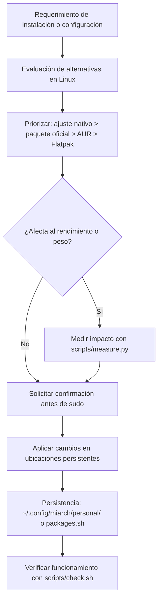

# Integración de Inteligencia Artificial

Miarch integra herramientas de inteligencia artificial tanto en la interfaz de usuario como en los flujos de trabajo de desarrollo y administración del sistema. La integración abarca un lanzador dedicado en Quickshell, aprovisionamiento automatizado de clientes de escritorio y herramientas de línea de comandos, una skill para agentes autónomos (`instalar-configurar`) y directrices de contribución definidas en `AGENTS.md`.

```
                  Super+C (Menú de IA)
                           │
       ┌───────────────────┴───────────────────┐
       ▼                                       ▼
Aplicaciones de Escritorio             Herramientas CLI
 • Claude Desktop                       • claude-code
 • Codex App                            • openai-codex
 • Antigravity 2.0                      • antigravity-cli (agy)
 • Hermes Desktop
```

---

## Menú de Inteligencia Artificial (`Super+C`)

El entorno gráfico implementa un menú específico de acceso rápido invocado mediante el atajo de teclado `Super+C`. Este componente forma parte de la shell del sistema (`config/quickshell/miarch/shell.qml`) desarrollada en Quickshell (Qt6/QML).

* **Identificación visual:** Emplea logotipos procedentes del paquete de iconos de código abierto LobeHub Icons (licencia MIT).
* **Detección de estado:** Lista las aplicaciones de escritorio integradas en el entorno. Si alguna de las aplicaciones no se encuentra instalada en el sistema, su entrada gráfica aparece atenuada (*dimmed*).

---

## Aplicaciones y Herramientas CLI

La instalación y el mantenimiento de las herramientas de inteligencia artificial se gestionan mediante el script de aprovisionamiento del repositorio (`packages.sh`).

### Catálogo de Software

| Herramienta | Tipo | Origen / Método de Instalación | Identificador del Paquete |
| :--- | :--- | :--- | :--- |
| **Claude Desktop** | Escritorio | AUR vía `yay` | `claude-desktop` |
| **Codex App** | Escritorio | AUR vía `yay` (empaqueta el `.deb` oficial de OpenAI con checksum) | `openai-chatgpt` |
| **Antigravity** | Escritorio | AUR vía `yay` (versión 2.0 desde servidores de Google) | `antigravity` |
| **Hermes Desktop** | Escritorio | Script instalador oficial de Nous Research en `~/.hermes` (límite de 30 min) | script oficial, sin paquete |
| **Claude Code** | CLI | AUR vía `yay` | `claude-code` |
| **Codex CLI** | CLI | pacman (repositorio oficial) | `openai-codex` |
| **Antigravity CLI** | CLI | AUR vía `yay` | `antigravity-cli` (comando `agy`) |

### Servicios de Soporte Local (Docker y Ollama)

`packages.sh` incluye el aprovisionamiento de Docker y Ollama para ejecución local de modelos. Para evitar el agotamiento de espacio en particiones raíz reducidas, el sistema implementa una regla de migración de datos: si la partición `/` dispone de menos de 100 GB y `/home` reside en una partición separada, los datos de almacenamiento de Docker y Ollama se trasladan automáticamente a `/home/.datos-pesados`.

---

## Skill para agentes: `instalar-configurar`

El repositorio incluye una skill estructurada bajo el formato estándar abierto Agent Skills en la ruta `skills/instalar-configurar/`. Esta skill define la metodología que un agente de inteligencia artificial debe seguir obligatoriamente para evaluar, instalar, configurar y verificar cambios en el sistema operativo Arch Linux / Miarch.



### Principios de Ejecución

1. **Selección óptima de dependencias:** El agente evalúa la alternativa más ligera y nativa disponible, priorizando ajustes existentes en el sistema, paquetes oficiales de los repositorios de Arch Linux, AUR y, en última instancia, Flatpak.
2. **Medición cuantitativa:** Cuando el consumo de recursos o el tamaño en disco es determinante, se utiliza el script de medición `scripts/measure.py`.
3. **Control de privilegios:** El agente solicita autorización explícita al usuario antes de ejecutar comandos con `sudo`.
4. **Persistencia ante actualizaciones:** Los cambios de configuración deben aislarse para no ser sobrescritos por el actualizador del sistema (`miarch-update`). Deben guardarse en el directorio personal `~/.config/miarch/personal/` (donde residen `hyprland.lua`, `kitty.conf` y `zshrc`) o incorporarse a `packages.sh`.
5. **Verificación:** una tarea no se da por terminada hasta comprobar que funciona de verdad (con `scripts/check.sh` cuando aplica).

### Despliegue de la skill

El script de instalación base (`install.sh`) detecta los entornos de agentes presentes en el sistema del usuario y replica automáticamente la skill `skills/instalar-configurar/` en sus respectivos directorios de configuración:

* `~/.claude/skills` (Claude Code)
* `~/.codex/skills` (Codex)
* `~/.gemini/config/skills` (Antigravity / Gemini)

---

## Normativa para Agentes en el Repositorio (`AGENTS.md`)

Todo agente de IA que opere dentro del código fuente de Miarch está sujeto a las directrices establecidas en el archivo raíz `AGENTS.md` (el cual es importado directamente por `CLAUDE.md`).

### Reglas Técnicas Obligatorias

* **Flujo de Git (GitFlow):** El trabajo se desarrolla en ramas `feat/*` o `fix/*` ramificadas desde `develop`. Los commits deben ser atómicos, seguir el estándar Conventional Commits y no incluir firmas o atribuciones automáticas de herramientas de IA. La fusión de ramas se realiza exclusivamente con `--no-ff`. Queda prohibido el uso de `--force` salvo instrucción explícita del usuario.
* **Control de versiones:** Los merges hacia la rama `main` junto con el etiquetado de versiones quedan restringidos a hitos mayores o peticiones expresas del usuario.
* **Documentación técnica:** Todo cambio visible para el usuario final requiere una entrada concisa redactada en español al inicio de `NOVEDADES.md`. Asimismo, el archivo de catálogo `docs/paquetes/` debe mantenerse en sincronía estricta con las declaraciones de `packages.sh`.
* **Diseño y entorno:** Respetar la paleta mate del sistema (sin colores neón). El único navegador admitido para pruebas y configuración es Google Chrome.
* **Protocolo de pruebas en ejecución:** Al realizar pruebas de interfaz o comandos gráficos, el agente no debe manipular las ventanas activas del usuario ni realizar capturas de la pantalla completa; debe utilizar un espacio de trabajo vacío y recortar las capturas a la ventana del proceso propio.

---

## Transparencia Técnica sobre Paquetes y Seguridad

El uso de paquetes no oficiales o compilaciones preliminares conlleva riesgos técnicos que deben ser considerados:

* **Paquetes de AUR:** Los paquetes obtenidos mediante `yay` provienen de la comunidad y carecen de firmas criptográficas oficiales de la distribución Arch Linux. Durante los procesos desatendidos o de actualización, se instalan con el modificador `--noconfirm`.
* **Codex App (`openai-chatgpt`):** Se trata de una compilación de vista previa (*preview*) no oficial para Arch Linux que desempaqueta el archivo `.deb` oficial de OpenAI y valida su suma de verificación (*checksum*).
* **Hermes Desktop:** Se instala descargando y ejecutando directamente el script remoto provisto por Nous Research en el directorio `~/.hermes`.
* **Antigravity:** Proporciona la versión 2.0 obtenida directamente desde la infraestructura de Google.
* **Privilegios de Docker:** La membresía en el grupo `docker` confiere un nivel de acceso equivalente al usuario administrador (`root`) en el sistema local.
