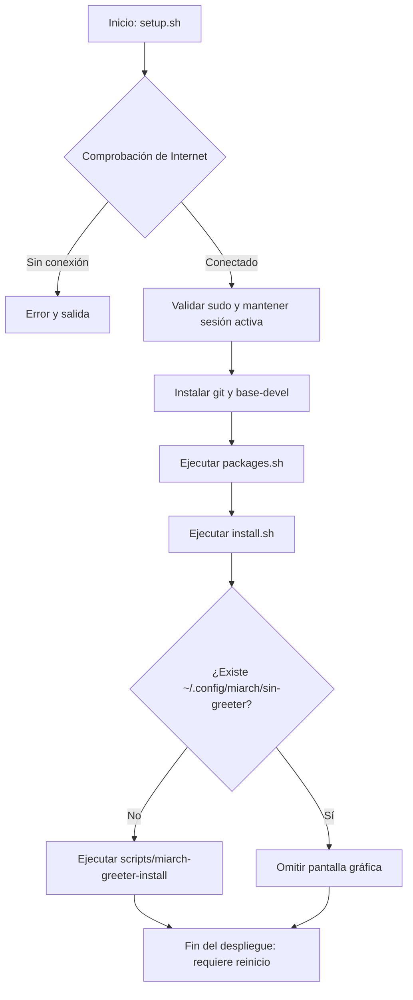

# Guía de instalación de Miarch

Documentación técnica del proceso de despliegue, configuración y primeros pasos en Miarch (Arch Linux + Hyprland con entorno de escritorio en Quickshell Qt6/QML).

---

## Requisitos del sistema

- **Distribución base:** Arch Linux (instalación mínima funcional).
- **Privilegios:** Usuario configurado en el archivo `sudoers`.
- **Conectividad:** Conexión activa a Internet.
- **Hardware de referencia probado:** Portátil con procesador Intel Core i5 de 8.ª generación (i5-8365U). En configuraciones con otra GPU, el controlador de aceleración de vídeo (`intel-media-driver`) debe sustituirse en `packages.sh`.

---

## Conexión previa sin Internet (Wi-Fi)

En una instalación mínima de Arch Linux sin entorno gráfico, la conectividad inalámbrica se gestiona mediante el demonio `iwd`:

1. Identificar la interfaz inalámbrica si no utiliza el nombre por defecto:
   ```bash
   iwctl station list
   ```
2. Conectar a la red Wi-Fi:
   ```bash
   iwctl station wlan0 connect "NOMBRE_DE_TU_RED"
   ```

Las conexiones Ethernet por cable quedan operativas de forma automática. Una vez completada la instalación de Miarch, la gestión de redes Wi-Fi se realiza desde el panel de control integrado en la barra de estado.

---

## Instalación en un comando

Para iniciar la instalación completa del sistema, ejecute la siguiente secuencia en la terminal:

```bash
sudo pacman -S --needed --noconfirm git && git clone https://github.com/alejandro-xoxo/Miarch ~/Miarch && ~/Miarch/setup.sh
```

El script `setup.sh` realiza las siguientes acciones:
1. Comprueba la conexión a Internet.
2. Solicita la contraseña de `sudo` una única vez y la mantiene activa en segundo plano durante todo el proceso.
3. Instala `git` y el metapaquete `base-devel`.
4. Ejecuta `packages.sh` para la provisión de software de repositorios oficiales y AUR.
5. Ejecuta `install.sh` para el despliegue de configuraciones, scripts y enlaces de usuario.
6. Instala y habilita la pantalla de acceso gráfico (`greetd` con interfaz Quickshell), salvo que exista el archivo de exclusión `~/.config/miarch/sin-greeter`.

La duración estimada es de aproximadamente 30 minutos debido a la compilación local de `quickshell-git`. Al finalizar, reinicie el equipo con `sudo reboot`.

> [!NOTE]
> Si el repositorio se descarga mediante un archivo ZIP de GitHub en lugar de `git clone`, los permisos de ejecución se pierden. En tal caso, ejecute `bash setup.sh`.

---

## Flujo de ejecución



La interfaz durante la ejecución (gestionada por `lib/ui.sh`) ofrece una barra de progreso general, animación de tiempo transcurrido por tarea y un resumen consolidado con las duraciones parciales. Todo el detalle técnico se registra en `~/.cache/miarch/instalacion.log`.

---

## Instalación paso a paso

Los componentes del despliegue pueden ejecutarse de manera independiente y son idempotentes.

### 1. Provisión de paquetes (`packages.sh`)

Instala dependencias oficiales mediante `pacman` y paquetes de AUR mediante `yay`:

```bash
cd ~/Miarch && ./packages.sh
```

Parámetros de consulta disponibles en `packages.sh`:
- `--etapas`: imprime cuántas etapas tiene (lo usa `setup.sh` para la barra de progreso).
- `--faltantes`: Lista los paquetes requeridos que no están presentes en el sistema.
- `--sobran`: lista paquetes que Miarch instaló antes y ya no usa, y que siguen instalados.

Componentes instalados:
- **AUR vía yay:** `quickshell-git`, `google-chrome`, `visual-studio-code-bin`, `claude-code`, `claude-desktop`, `antigravity-cli`, `antigravity`, `openai-chatgpt`, `protonup-qt`.
- **Ecosistema Gaming:** Habilitación del repositorio multilib, selección del controlador Vulkan según el fabricante de la GPU, Steam, GameMode, MangoHud, Gamescope, `zram` (si no existe partición o archivo de intercambio swap) y compatibilidad con `ntsync`.
- **Servicios de virtualización e IA:**
  - Docker y Ollama: la ruta de almacenamiento se migra a `/home/.datos-pesados` únicamente si la partición raíz `/` tiene un tamaño inferior a 100 GB y `/home` reside en una partición separada.
  - Hermes Desktop: instalado en `~/.hermes` mediante su script oficial de instalación (tiempo límite de espera: 30 minutos).
- **Limpieza de paquetes obsoletos:** Remoción de `dunst`, `hermes-webui-desktop-bin`, `hermes-webui-desktop-appimage` y `alpaka-desktop-bin`.

### 2. Despliegue de configuraciones (`install.sh`)

Aplica los entornos de configuración de usuario y scripts del sistema:

```bash
cd ~/Miarch && ./install.sh
```

Operaciones efectuadas:
- Copia el contenido de `config/` y `scripts/` al directorio `$HOME`.
- Mantiene copias de seguridad de archivos sobreescritos bajo el formato `*.bak-FECHA`, conservando únicamente las dos versiones más recientes.
- Preserva el estado de las variables de personalización del panel: `ESCALA`, `KB`, `NATURAL`, `TAP`, `SENS`, `CURSOR`, `MOVIMIENTO`, `ANIM` y `BLUR`.
- Genera la estructura de configuración persistente `~/.config/miarch/personal/` (`hyprland.lua`, `kitty.conf`, `zshrc`), cuyos archivos nunca son modificados por actualizaciones.
- Despliega la skill `instalar-configurar` en `~/.claude/skills`, `~/.codex/skills` y `~/.gemini/config/skills` cuando detecta la presencia de dichos agentes.
- Sincroniza extensiones y configuración de Neovim mediante Lazy.nvim.
- Configura el arranque automático de Hyprland en `tty1`.
- Detiene instancias residuales del demonio `dunst`.
- Aplica el fondo de pantalla predeterminado y extrae la paleta de colores.

---

## Pantalla de inicio de sesión gráfica (Greeter)

Miarch incluye de forma predeterminada un gestor de acceso gráfico basado en `greetd` y una interfaz dedicada en Quickshell ejecutada sobre su propia instancia de Hyprland (usuario de sistema `greeter`, ubicado en `config/greeter`).

| Propiedad | Detalle |
| :--- | :--- |
| **Instalador** | `scripts/miarch-greeter-install` |
| **Archivos del sistema** | `/usr/share/miarch/greeter`, `/var/lib/miarch-greeter` |
| **Copia de seguridad** | `/etc/greetd/config.toml.miarch-bak` |
| **Mecanismo de tolerancia a fallos** | Si la interfaz gráfica falla durante los primeros 8 segundos, conmuta automáticamente a acceso por texto (`agreety`). |

### Exclusión previa (Opt-out)
Para mantener el inicio de sesión estándar por consola (`tty1`) e impedir la instalación del gestor gráfico durante `setup.sh`:

```bash
mkdir -p ~/.config/miarch && touch ~/.config/miarch/sin-greeter
```

### Instalación manual
```bash
./scripts/miarch-greeter-install
```

### Procedimiento de recuperación
Si el inicio gráfico queda bloqueado o presenta incidencias de acceso:
1. Cambiar a una consola virtual mediante `Ctrl + Alt + F2`.
2. Iniciar sesión con el usuario del sistema.
3. Deshabilitar `greetd` y restaurar la consola estándar:
   ```bash
   sudo systemctl disable greetd && sudo systemctl enable getty@tty1
   ```
4. Reiniciar el sistema: `sudo reboot`.

---

## Primer inicio y acceso a herramientas

Tras autenticarte, Hyprland inicia la sesión gráfica y carga el escritorio en Quickshell. La primera vez, inicia sesión en cada herramienta: `claude`, `codex`, `agy` y `gh auth login`.

- **Atajos de acceso rápido:**
  - `Super + Espacio`: Lanzador de aplicaciones (filtrado por abreviaturas y ordenado por frecuencia de uso).
  - `Super + C`: Menú de herramientas de inteligencia artificial.
  - `Super + Esc`: Panel de configuración del sistema.
  - `Super + Shift + Esc`: Menú de energía (pestañas de Energía y Atajos de teclado).
  - `Super + L`: Bloqueo de sesión.
- **Herramientas de IA disponibles:**
  El menú `Super + C` centraliza el acceso a las aplicaciones de escritorio: Claude Desktop (`claude-desktop`), Codex App (`openai-chatgpt`), Antigravity (`antigravity`) y Hermes Desktop (`~/.hermes`). Las aplicaciones no instaladas se muestran atenuadas.
  Asimismo, el sistema deja operativas las interfaces de línea de comandos correspondientes: `claude-code`, `openai-codex` y `antigravity-cli` (`agy`).

---

## Modelo de actualizaciones

El sistema incorpora un gestor de actualización en dos fases (revisión y aplicación controlada) accesible desde el icono de nube en la barra de estado o mediante el comando `miarch-update`.

Para una descripción detallada de la arquitectura de actualización, variables y parámetros de ejecución, consulte [actualizador.md](actualizador.md).

### Migración en versiones antiguas sin icono de actualización
Si dispone de una versión anterior de Miarch que no incluye el módulo de actualización en la barra, ejecute este comando por única vez en la terminal para desplegar el actualizador y recargar el entorno:

```bash
cd ~/Miarch && git pull --ff-only && bash install.sh && hyprctl reload && (qs kill -c miarch; setsid qs -c miarch >/dev/null 2>&1 &)
```

Para una reinstalación exhaustiva de componentes mediante consola:
```bash
cd ~/Miarch && git pull && ./setup.sh
```

---

## Consideraciones de seguridad

- **Repositorios oficiales (pacman):** Paquetes firmados digitalmente mediante el anillo de claves de Arch Linux.
- **Arch User Repository (AUR via yay):** Los paquetes de AUR (`quickshell-git`, `google-chrome`, `visual-studio-code-bin`, `claude-code`, `claude-desktop`, `antigravity-cli`, `antigravity`, `openai-chatgpt`, `protonup-qt`) son mantenidos por la comunidad y no cuentan con firma de Arch Linux. El instalador automatizado los procesa con el parámetro `--noconfirm`.
- **Hermes Desktop:** Se instala descargando y ejecutando el script oficial distribuido por Nous Research directamente en el directorio local `~/.hermes`.
- **Codex App:** el paquete `openai-chatgpt` reempaqueta el `.deb` oficial de la vista previa de OpenAI para Linux, comprobado por checksum; no es un paquete oficial para Arch.
- **Grupo Docker:** La inclusión de la cuenta de usuario en el grupo `docker` concede privilegios equivalentes al usuario de administración `root`.
- **Oh My Zsh:** El repositorio oficial se clona exclusivamente vía `git`, sin ejecución de scripts remotos arbitrarios durante la instalación.

---

## Consumo de recursos

Métricas registradas en un equipo portátil con procesador Intel Core i5-8365U, manteniendo en ejecución activa Google Chrome, Visual Studio Code, Spotify y Claude:

| Componente | Carga de CPU | Uso de memoria RAM |
| :--- | :--- | :--- |
| **Quickshell** (entorno de escritorio) | ~9 % de un núcleo | ~400 MB |
| **Hyprland** (compositor Wayland) | ~10 % de un núcleo | ~230 MB |

El consumo global del sistema reside predominantemente en las aplicaciones de usuario iniciadas durante la sesión, manteniendo el compositor y el shell un impacto moderado sobre los recursos de hardware.
