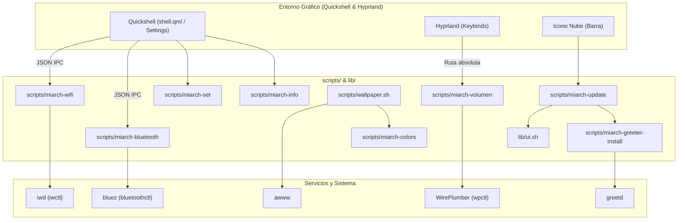

# Scripts y Utilidades de Miarch

Documentación técnica de los scripts auxiliares ubicados en `scripts/` y la biblioteca visual `lib/ui.sh`, detallando su propósito, modo de ejecución, dependencias de llamada y los parámetros de línea de comandos disponibles en las herramientas centrales de mantenimiento.

---

## Catálogo de Scripts

| Script | Propósito | Sintaxis de Uso | Invocador |
| :--- | :--- | :--- | :--- |
| `lib/ui.sh` | Biblioteca de interfaz en terminal con tres niveles (ASCII, consola, *rich*), paleta púrpura, logotipo animado, indicadores de espera (*spinner*), barras de progreso y cajas de resumen con duración. | `source lib/ui.sh` | Scripts de instalación y actualización (`setup.sh`, `install.sh`, `miarch-update`). |
| `scripts/miarch-update` | Gestor de actualización en dos fases (Revisión interactiva y Aplicación secuencial con verificación de cambios mediante Git, paquetes y estado de sesión). | `miarch-update [--forzar]` | Usuario desde terminal o clic en el icono de nube de la barra (clic derecho ejecuta `--forzar`). |
| `scripts/miarch-colors` | Generación y extracción de paleta de colores mate a partir del fondo de pantalla. Exporta configuraciones a Quickshell (`~/.cache/miarch/colors.json`), kitty, kdeglobals, qt6ct y el greeter (`/var/lib/miarch-greeter`). | `miarch-colors <ruta_imagen>` | `scripts/wallpaper.sh`, `install.sh` y `scripts/miarch-fetch`. |
| `scripts/miarch-set` | Aplica modificaciones a las variables de configuración del panel y del entorno de escritorio en tiempo de ejecución. | `miarch-set <ajuste> <valor>` (ajustes: `anim`, `blur`, `escala`, `teclado`, `scrollnat`, `tap`, `sens`, `cursor`, `movimiento`, `barra`, `texto`, `contraste`, `gif`, `perfil`, `brillo`) | Panel de Ajustes de Quickshell (Super+Esc) o terminal. |
| `scripts/miarch-wifi` | Puente entre la interfaz de usuario y el demonio `iwd` (`iwctl`) para gestión de redes inalámbricas con salida en formato JSON. Manejo de contraseñas mediante variable `MIARCH_PASS` y asignación por PTY. | `miarch-wifi <list\|scan\|connect\|connect-hidden\|disconnect\|forget\|power>` | Paneles de conexión de Quickshell. |
| `scripts/miarch-bluetooth` | Mediador para emparejamiento Bluetooth seguro mediante `bluetoothctl` con agente `NoInputNoOutput`, registro de confianza y conexión automática. Salida estructurada en JSON y registro rotado en `~/.cache/miarch/bluetooth.log`. | `miarch-bluetooth pair <MAC>` | Paneles de conexión de Quickshell. |
| `scripts/miarch-volumen` | Control de nivel de audio mediante `wpctl`. Reproduce el sonido temático de freedesktop (límite de 110 ms) y emite señal OSD a Quickshell (`qs ipc call osd mostrar`) durante 1.2 segundos. | `miarch-volumen <up\|down\|mute>` | Atajos de teclado en Hyprland (llamado por ruta absoluta `~/.local/bin/miarch-volumen`). |
| `scripts/miarch-info` | Recopila telemetría y especificaciones de hardware en formato estructurado JSON. | `miarch-info` | Vista del sistema en el panel de configuración de Quickshell. |
| `scripts/miarch-fetch` | Muestra resumen del sistema mediante `fastfetch`, redimensionando y ajustando la salida al ancho disponible de la ventana de terminal. | `miarch-fetch` | `home/.zshrc` (al abrir una terminal) o a mano. |
| `scripts/miarch-steam` | Inicializador de Steam que calcula y aplica la escala de interfaz de usuario de acuerdo con la escala activa de la pantalla. | `miarch-steam` | Lanzador de Steam que crea `packages.sh`/`install.sh`, o a mano. |
| `scripts/miarch-modo-juego` | Hook de ejecución acoplado a GameMode para alternar perfiles energéticos del sistema. | `miarch-modo-juego` | GameMode, al empezar y terminar un juego (`~/.config/gamemode.ini`). |
| `scripts/miarch-chrome-tema` | Limpia los parámetros de color personalizados asignados al perfil del navegador Google Chrome. | `miarch-chrome-tema` | `install.sh`, o a mano. |
| `scripts/miarch-greeter-install` | Instalador y configurador de la pantalla de inicio de sesión (`greetd` + Quickshell). Copia archivos a `/usr/share/miarch/greeter`, prepara `/var/lib/miarch-greeter`, respalda `/etc/greetd/config.toml` y habilita el servicio. | `./scripts/miarch-greeter-install` (con tu usuario normal, no como root: pide `sudo` por dentro) | `setup.sh`, `miarch-update` o a mano. |
| `scripts/wallpaper.sh` | Selección y asignación de fondo de pantalla aleatorio utilizando `awww`, desencadenando la actualización cromática mediante `miarch-colors`. | `wallpaper.sh` | Hyprland (al iniciar y con `Super + W`) y el panel de Ajustes. |
| `scripts/tomar-capturas` | Automatización de capturas de pantalla para documentación en formato JPEG a 1280 px de ancho. | `tomar-capturas` | Desarrollador para generación de activos visuales del repositorio. |

---

## Opciones de Línea de Comandos

### `packages.sh`

Script encargado de la instalación, resolución de dependencias por fabricante (GPU, drivers Vulkan, multilib) y saneamiento de paquetes del sistema y AUR. Dispone de indicadores de consulta que no modifican el sistema:

* `--etapas`: imprime cuántas etapas tiene el script; `setup.sh` lo usa para dibujar la barra del total.
* `--faltantes`: Comprueba el árbol de dependencias requerido contra el estado local del sistema y lista exclusivamente los paquetes pendientes de instalación.
* `--sobran`: lista paquetes que Miarch ya no usa y siguen instalados (hoy: `dunst`, `hermes-webui-desktop-bin`, `hermes-webui-desktop-appimage`, `alpaka-desktop-bin`).

### `miarch-update`

Actualizador en dos fases (ver [actualizador.md](actualizador.md)):

* `--forzar`: vuelve a aplicar las configuraciones y los scripts (`install.sh`) aunque no haya cambios nuevos que descargar.
