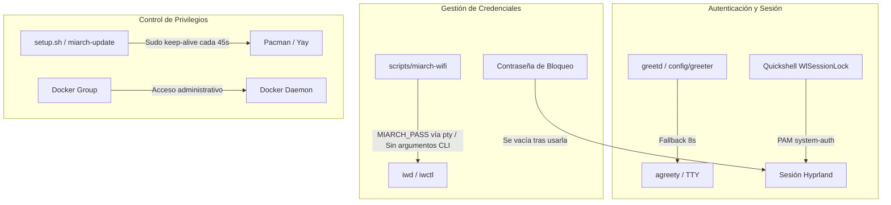
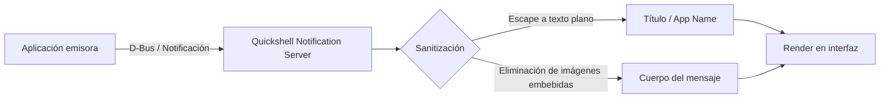
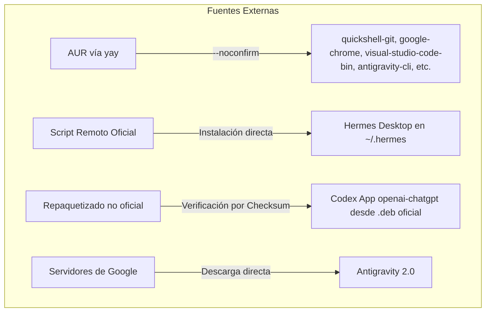

# Modelo de Seguridad y Calidad de Miarch

Este documento describe la arquitectura de seguridad, la gestión de privilegios y credenciales, el control de código de terceros y el proceso de revisión de calidad implementado en Miarch v1.0.



---

## 1. Pantalla de Bloqueo (Lock Screen)

La pantalla de bloqueo está implementada en Quickshell (`config/quickshell/miarch/shell.qml`) utilizando el protocolo `WlSessionLock` de Wayland integrado con PAM (`system-auth`).

### Propiedades de Seguridad

* **Superficie de bloqueo estricta**: Quickshell instancia una superficie de bloqueo independiente por cada monitor conectado.
* **Validación PAM sincrónica**: Todo flujo de desbloqueo requiere un resultado afirmativo en vivo de PAM (`system-auth`). No existe ningún desbloqueo automático de pruebas.
* **Cancelación de carrera en rebloqueo**: Si se emite un nuevo evento de bloqueo mientras una animación de desbloqueo autenticada está en progreso, la secuencia se invalida inmediatamente y el sistema regresa al estado bloqueado sin liberar la sesión.
* **Ciclo de vida de la contraseña**: la variable con lo tecleado se vacía en cuanto se usa (también si PAM no llega a arrancar). QML no permite garantizar el borrado físico de esa memoria.
* **Secuencia de desbloqueo controlada**: La transición visual dura 5.6 segundos (barras cinematográficas del 12.8% de altura, desplazamiento del fondo de +12%, viñeta, texto MIARCH "by alejandro-xoxo", sonido de teclado mecánico generado por código, sin muestras de terceros acompañando la salida de `journalctl` mecanografiada). Si la autenticación falla en cualquier punto previo a la concesión PAM, la animación no se ejecuta.

---

## 2. Pantalla de Inicio de Sesión (greetd) y Recuperación

El gestor de acceso gráfico corre bajo `greetd` ejecutando una sesión mínima de Hyprland con la interfaz de Quickshell (`config/greeter`) bajo el usuario del sistema `greeter`.

### Despliegue y Mecanismos de Falla

* **Instalación**: El script `scripts/miarch-greeter-install` instala `greetd`, copia los recursos a `/usr/share/miarch/greeter`, asigna la paleta y fondo en `/var/lib/miarch-greeter`, respalda `/etc/greetd/config.toml` como `config.toml.miarch-bak` y habilita el servicio de `systemd`.
* **Omisión durante instalación**: Si existe el archivo `~/.config/miarch/sin-greeter`, `setup.sh` omite el despliegue del greeter gráfico.
* **Plan B si el login gráfico falla**: Si el greeter gráfico falla al iniciar en un intervalo de 8 segundos, el sistema recurre automáticamente a la interfaz en modo texto (`agreety`).
* **Procedimiento de recuperación manual**: Si el usuario no puede acceder a la interfaz gráfica, se puede acceder a una consola virtual y restaurar el inicio estándar de terminal:
  1. Cambiar a TTY2 mediante `Ctrl+Alt+F2`.
  2. Deshabilitar `greetd` y restaurar la consola estándar:
     ```bash
     sudo systemctl disable greetd && sudo systemctl enable getty@tty1
     ```

---

## 3. Gestión de Contraseñas y Credenciales

| Ámbito | Mecanismo | Mitigación Implementada |
| :--- | :--- | :--- |
| **Bloqueo de sesión** | PAM (`system-auth`) | La variable con lo tecleado se vacía tras el intento. No se escribe en archivos ni registros. |
| **Conexiones Wi-Fi** | `scripts/miarch-wifi` e `iwd` (`iwctl`) | La clave no se pasa en los argumentos de la línea de comandos (`argv`). Se exporta temporalmente a la variable de entorno `MIARCH_PASS` y se inyecta mediante un pseudo-terminal (`pty`). |
| **Cambio de credenciales Wi-Fi** | Interfaz de conexiones | Si una red almacenada rechaza la autenticación por cambio de contraseña, el panel solicita interactivamente la nueva credencial. |
| **Registros de red** | `~/.cache/miarch/wifi.log` | El registro se recorta cuando pasa de 100 KB; guarda acciones y nombres de red, no contraseñas. |

Las operaciones de desconexión, apagado de interfaz y eliminación de perfiles de red verifican el estado real resultante directamente sobre `iwd`.

---

## 4. Servidor de Notificaciones y Sanitización

Quickshell actúa como el servidor de notificaciones nativo del entorno de escritorio (reemplazando a implementaciones previas como `dunst`).



* **Prevención de inyección de marcado**: El título (`summary`) y el nombre de la aplicación (`app_name`) se procesan estrictamente como texto plano, evitando la ejecución de código o renderizado arbitrario de entidades.
* **Eliminación de contenido embebido**: Las etiquetas de imágenes dentro del cuerpo de la notificación se suprimen antes del renderizado en los componentes visuales de QML.
* **Comportamiento**: Las alertas críticas permanecen en pantalla hasta su cierre manual. Se provee control de cierre masivo por interfaz y terminal (`qs -c miarch ipc call notif cerrar`).

---

## 5. Privilegios y Pasos Administrativos

### Escalado de Privilegios (`sudo`)

* **Instalación inicial (`setup.sh`)**: Solicita la contraseña administrativa una sola vez al inicio y mantiene activa la sesión de sudo en segundo plano mientras dura el aprovisionamiento.
* **Actualizaciones (`miarch-update`)**:
  * **Fase 1 (Revisión)**: No ejecuta comandos privilegiados ni altera archivos del sistema. Consulta cambios remotos vía `git fetch`, configuraciones pendientes en `~/.cache/miarch/configs-aplicadas`, paquetes faltantes/obsoletos, y chequea actualizaciones con `checkupdates` y `yay -Qua`.
  * **Fase 2 (Aplicación)**: Solicita confirmación explícita al usuario. Tras ser autorizado, solicita `sudo` una vez y renueva la marca de tiempo automáticamente cada 45 segundos para prevenir expiraciones durante compilaciones extensas (como `quickshell-git`).

### Contenedores y Almacenamiento Pesado

* **Grupo Docker**: La inclusión del usuario en el grupo `docker` equivale funcionalmente a privilegios de administración completa (`root`) en el sistema local.
* **Reubicación de datos**: Docker y Ollama reubican su almacenamiento a `/home/.datos-pesados` solo si `/` tiene menos de 100 GB y `/home` es otra partición.

---

## 6. Código de Terceros y Dependencias Externas

Miarch integra paquetes y herramientas externas necesarias para flujos de trabajo de desarrollo, IA y ejecución de software:



### Factores de Riesgo Conocidos

1. **Paquetes de AUR**: Instalados mediante `yay` con el modificador `--noconfirm`. No están firmados oficialmente por las claves de lanzamiento de Arch Linux y dependen del mantenimiento de la comunidad.
2. **Hermes Desktop**: Se instala ejecutando el script oficial remoto de Nous Research directamente hacia `~/.hermes`, con un tiempo límite de ejecución de 30 minutos.
3. **Codex App (`openai-chatgpt`)**: Es un paquete que reempaqueta el binario `.deb` oficial de la versión preliminar de OpenAI para Linux validado por suma de verificación (checksum), pero no constituye un paquete oficial de la distribución.
4. **Permisos de Docker**: La membresía en el socket de Docker otorga control administrativo completo sobre el anfitrión.

---

## 7. Proceso de Revisión Previo a la Versión 1.0

Previo al lanzamiento de la versión 1.0, se realizó un proceso sistemático de verificación de sintaxis, pruebas en entornos aislados y revisión cruzada de código con modelos de IA (Antigravity con Gemini Flash, esfuerzo medio). Cada hallazgo reportado fue inspeccionado y comprobado manualmente.

### Verificación Automatizada

* **Scripts de Bash**: Verificados con `bash -n`.
* **Scripts de Python**: Analizados con validador sintáctico (`python parse`).
* **Componentes de interfaz**: Archivos QML analizados con `qmllint`.
* **Entornos de prueba**: Los flujos de `setup.sh` y `miarch-update` se ejecutaron en sandboxes con variables `$HOME` temporales y comandos privilegiados simulados (stubbed).

### Hallazgos Reales Corregidos

1. **Condición de carrera en rebloqueo**: Si el usuario intentaba bloquear el sistema mientras transcurría la animación de desbloqueo autenticada, la interfaz podía quedar abierta sin requerir contraseña. Se corrigió forzando la cancelación de la secuencia y el restablecimiento del estado cerrado.
2. **Login sin teclado**: si `greetd` fallaba al arrancar la sesión después de la animación de entrada, la pantalla de login se quedaba ignorando el teclado. Ahora vuelve a aceptar la contraseña.
3. **Restricción `ProtectHome` en Ollama**: Al mover los modelos a `/home/.datos-pesados`, el servicio de systemd de Ollama no podía leerlos porque su servicio trae `ProtectHome=yes`, que hace invisible `/home`. Ahora el servicio recibe `ProtectHome=read-only` y acceso de escritura solo a la carpeta de modelos.
4. **Docker y sus datos existentes**: `/var/lib/docker` solo lo puede listar root, así que el instalador la veía siempre vacía y podía redirigir el almacenamiento escondiendo datos que ya existían. Ahora la comprueba con `sudo`.
5. **Caducidad de `sudo` en compilaciones largas**: durante tareas largas (por ejemplo, la de Hermes Desktop) la contraseña de `sudo` caducaba y un paso posterior habría esperado una contraseña invisible. El actualizador ahora la renueva cada 45 segundos.
6. **Formato en notificaciones**: el resumen y el nombre de la app podían interpretarse como formato, y el cuerpo admitía imágenes incrustadas. Ahora el resumen y el nombre son texto plano y se quitan las imágenes del cuerpo.
7. **Orden en el actualizador**: `miarch-update` recargaba el escritorio antes de actualizar los paquetes, dejando corriendo binarios viejos. Ahora recarga al final.
8. **Desbloqueo de pruebas**: existía un temporizador de desbloqueo automático activado por una variable de entorno, solo para pruebas. Se eliminó: ninguna vía desbloquea sin PAM.

### Falsos Positivos Descartados

* **Ausencia de superficie de bloqueo en configuraciones multimonitor**: El análisis automático señaló falta de cobertura de pantalla; se desestimó al confirmar que Quickshell genera de forma nativa una superficie `WlSessionLock` individual por cada monitor activo.
* **Ajustes que el actualizador no conservaría**: se señaló que la expresión que conserva tus ajustes exigía comillas y perdería los numéricos; se comprobó que todos los valores van entre comillas.

---

## 8. Alcance y Limitaciones

> [!IMPORTANT]
> Este documento y los controles descritos son el resultado de un proceso de autorrevisión técnica, verificación sintáctica y pruebas en cajas de arena por parte del autor. **No constituyen una auditoría de seguridad formal o independiente realizada por una entidad certificadora de terceros.**

El sistema está diseñado para un entorno de escritorio personal, asumiendo un modelo de amenazas acorde al uso individual y a la ejecución de software desde repositorios oficiales, AUR y servicios de IA.

---

## 9. Reportar un Problema

Si identifica una vulnerabilidad, fallo en la gestión de credenciales o defecto en los scripts del sistema, abra una incidencia técnica en el repositorio del proyecto:

* **Seguimiento de problemas**: [github.com/alejandro-xoxo/Miarch/issues](https://github.com/alejandro-xoxo/Miarch/issues)
